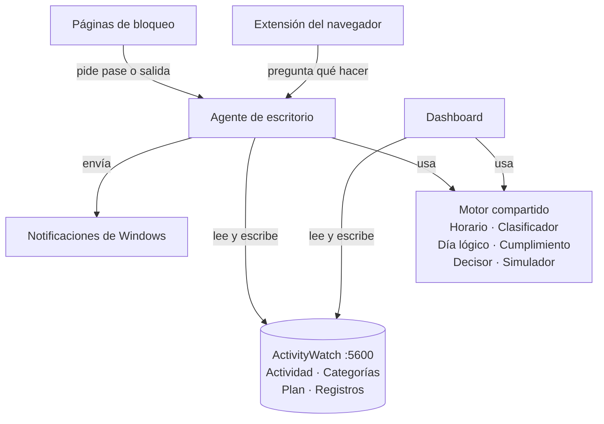

# Arquitectura — Rastreador de tiempo + modo meta

> Especificación para construir el sistema por fases con Claude Code. Las tareas, con dependencias y dificultad, están en [tareas.md](tareas.md).

## 1. Objetivo

Cumplir los horarios que Dremy se propone. Para eso el sistema:

1. Registra en qué se va el tiempo en la PC y lo clasifica (estudio, distracción, neutral).
2. Guarda su plan: horario de clases, rutinas y bloques de estudio.
3. Compara el plan con lo que de verdad pasó.
4. Durante los bloques, interviene según el nivel elegido: aviso, fricción o total.
5. Lo muestra todo en un dashboard con su propio estilo.

**Métrica principal:** % del horario cumplido, por día y por semana.

## 2. Alcance

- Una PC con Windows. Cubre toda la PC: apps de escritorio y páginas web.
- Todo local (localhost) y de uso personal.
- Fuera de alcance: el celular (ya tiene su propio bloqueo), varias PCs, nube y cuentas.

## 3. Principios

- **Plan contra realidad.** La distracción solo es fallo dentro de un bloque; en tiempo libre solo se mide.
- **Un solo motor.** La misma lógica decide en el simulador del dashboard y en el bloqueo real. Lo que se ve simulado es lo que pasará.
- **ActivityWatch guarda todo.** Actividad, categorías, plan (en sus ajustes) y registros propios (en buckets). No hay otra base de datos.
- **Día lógico.** El día va de despertar a dormir, no de 00:00 a 00:00.
- **Simple primero.** Sin frameworks ni paso de build en el dashboard; umbrales ajustables; cada fase deja algo usable.
- **Privacidad.** Los títulos de ventana y las URLs no salen de la PC ni se suben al repositorio.

## 4. Decisiones tomadas

| Tema | Decisión | Motivo |
|---|---|---|
| Recolección | ActivityWatch: watchers de ventana, AFK y web | Ya instalado, local, con API y lenguaje de consultas |
| Almacenamiento | Ajustes y buckets propios de ActivityWatch | Sin base de datos extra |
| Dashboard | HTML, CSS y JS con módulos ES, sin framework ni build, servido por AW en `/pages/rastreador/` | Mismo origen que la API (sin CORS) y simple de mantener |
| Gráficos | Apache ECharts como archivo local | Trae línea de tiempo, mapas de calor, calendario y gráficos radiales |
| Lógica | Motor en JS puro, compartido por el dashboard y el agente | Simulación = realidad |
| Agente | Node.js, arranca con Windows | Reutiliza el motor en JS; controla apps y notificaciones |
| Bloqueo web | Extensión Manifest V3 que consulta al agente | Bloquea por URL y muestra páginas propias |
| Niveles | Aviso, fricción y total, elegidos por bloque | Intervención escalonada |
| Clasificación | Categorías de ActivityWatch como fuente única | Las reglas se editan en un solo lugar |
| Respaldo | Exportar e importar el plan en JSON | Los ajustes viven en la base de datos de AW |

## 5. Arquitectura por capas

| Capa | Componentes | Qué hace |
|---|---|---|
| Interfaz | Dashboard, páginas de bloqueo, notificaciones | Lo que Dremy ve y usa |
| Ejecutores | Agente de escritorio, extensión del navegador | Actúan en vivo sobre apps y webs |
| Motor | Horario, Clasificador, Día lógico, Cumplimiento, Decisor, Simulador | Solo calcula: sin pantalla, red ni reloj |
| Datos | ActivityWatch | Recolecta y guarda |

Ningún componente necesita tocar la configuración CORS de ActivityWatch: el dashboard y las páginas de bloqueo se sirven desde el propio AW (mismo origen), el agente no es un navegador y la extensión solo habla con el agente.

## 6. Componentes

### 6.1 Dashboard

- **Responsabilidad:** mostrar todo (vistas de §13), editar el plan y los niveles, registrar check-ins y correr el simulador.
- **Lee:** actividad, categorías, plan, niveles y registros (AW); estado en vivo (agente, desde la fase 6).
- **Escribe:** plan y niveles (ajustes de AW) y check-ins (bucket propio).
- **Tecnología:** HTML, CSS y JS con módulos ES; ECharts local; rutas con `#` (por ejemplo `#/hoy`), porque AW solo sirve archivos estáticos.
- **Dirección:** `http://localhost:5600/pages/rastreador/`

### 6.2 Motor (lógica compartida)

Módulos puros: no usan DOM, red ni el reloj del sistema. "Ahora" y los datos entran por parámetros. Cada función tiene pruebas.

| Módulo | Entrada | Salida |
|---|---|---|
| Horario | Plan + fecha | Bloques concretos del día lógico |
| Clasificador | Eventos de AW, o una actividad suelta (app + título) | Segmentos clasificados; huecos como AFK o Sin PC |
| Día lógico | Segmentos + check-ins | Inicio y fin del día, horas despierto |
| Cumplimiento | Bloques + segmentos + check-ins + umbrales | Estado por bloque, % del día y de la semana, horas por curso y por área |
| Decisor | Actividad + bloque activo + nivel + pases + avisos acumulados | Acción: permitir, aviso, fricción o bloqueo |
| Simulador | Segmentos de un día + plan + nivel | Intervenciones simuladas y minutos que se habrían cortado |

### 6.3 Agente de escritorio

- Proceso Node.js que arranca al iniciar sesión en Windows y siempre está encendido.
- **Funciones:** recordatorios del horario, check-in al despertar, control de apps según el nivel, decisiones para la extensión y un latido para detectar si se apagó.
- **Lee:** plan, niveles y categorías de AW (cada minuto); la ventana activa y los procesos directamente de Windows, porque AW guarda los datos con hasta ~10 s de retraso.
- **Escribe:** sesiones, intervenciones y latido (buckets propios).
- **API local:** solo en `127.0.0.1`, puerto propio (propuesto: 5650). Responde CORS solo a los orígenes del dashboard (`http://localhost:5600` y `http://127.0.0.1:5600`, que para el navegador son distintos) y a la extensión.

### 6.4 Extensión del navegador

- Manifest V3 (Chrome, Edge o Brave).
- En cada navegación pregunta al agente qué hacer (le envía la URL y el título) y, si toca, redirige a la página de bloqueo correspondiente.
- Cada 30 s envía al agente un latido con el nombre de su navegador; así el agente sabe qué navegadores tienen la extensión (§11).
- Nunca bloquea `localhost:5600` ni `127.0.0.1:5600`. Si el agente no responde, mantiene la última decisión conocida hasta el fin del bloque.

### 6.5 Páginas de bloqueo

- Viven en `web/bloqueo/`, con el mismo estilo que el dashboard.
- Aviso, fricción, total y salida de emergencia. Muestran el bloque, el tiempo restante y el "por qué" que Dremy escribió al planificarlo.
- Las usan la extensión (webs) y el agente (apps, abriéndolas en el navegador).

### 6.6 ActivityWatch

Ya instalado. Watchers: ventana, AFK y web (aw-watcher-web). Detalles técnicos en §14.

## 7. Clasificación

**Clases** = primer nivel del árbol de categorías de AW.

| Clase | Subcategorías (segundo nivel) |
|---|---|
| Estudio | Una por **área**: Programación, Matemáticas, Inglés, Humanidades |
| Distracción | Video, Redes, Juegos, Otros |
| Neutral | Comunicación, Sistema, Otros (aquí van YouTube, Spotify y Obsidian) |
| IA | Sin subcategorías: asistentes y herramientas de IA (Claude, ChatGPT, Gemini, Antigravity…) |
| Sin clasificar | Lo que ninguna regla reconoce (Uncategorized en AW) |

- **Áreas, no cursos.** Los cursos cambian cada ciclo; las áreas no. Los cursos viven en el plan (§8) y cada uno apunta a un área. Así, cambiar de ciclo no obliga a tocar las categorías de AW.
- **IA** es una clase aparte para medir el uso de IA. No cuenta como foco (§9) y no se bloquea en ningún nivel (§11). Su regla lleva prioridad 30, así que gana siempre, aunque el título tenga palabras de un área (por ejemplo, una conversación sobre integrales cuenta como IA).
- **YouTube** está en Neutral porque se usa para todo (música, clases, inglés, ejercicios, distraerse). Si el título trae palabras de un área, gana Estudio: tiene el mismo rango (20) y va después en la lista.
- Las terminales (Warp, Windows Terminal, PowerShell…) van en Estudio > Programación.

**Estados** (no son categorías): **AFK** = PC encendida sin uso; **Sin PC** = no hay datos (apagada o suspendida).

**Contexto** de cada segmento según el plan: en bloque de estudio, en clase, en rutina o libre.

**Reglas**

- Se editan en ActivityWatch (Ajustes → Categorización) y se leen del ajuste `classes`.
- Son regex que se prueban contra **todos los campos de texto** de `data` del evento: la app y el título en los eventos de ventana, y también la URL en los eventos del navegador (así lo hace `classify.rs` cuando la regla no trae `select_keys`). Por eso el clasificador en vivo del agente recibe app, título y, si es una web, la URL que le manda la extensión.
- Si varias coinciden, gana la de mayor rango: su prioridad si la tiene; si no, profundidad × 10 (la más profunda). En empate gana la que va **después** en la lista. El servidor Python (`aw-core/aw_transform/classify.py`) y el de Rust aplican el mismo criterio.
- Para bloquear por ruta (por ejemplo `youtube.com/shorts`) hay patrones de URL extra en los niveles (§11).
- **URLs visibles:** el dashboard muestra la URL completa de cada página web, en el detalle de la línea de tiempo y en los más usados (agrupados por dominio, con sus URLs), para ver exactamente en qué se estuvo. Es solo local: las URLs no salen de la PC (§3).

## 8. Plan: horario de clases y rutinas

Se guarda en el ajuste `rastreador-plan` de AW y se puede exportar e importar en JSON.

**Ciclo:** nombre (2026-2), fecha de inicio y fecha de fin.

**Cursos**

| Campo | Descripción | Ejemplo |
|---|---|---|
| id | Identificador corto | bd1 |
| nombre | Nombre visible | BD I |
| area | Área de Estudio en AW a la que pertenece (§7) | Estudio > Programación |
| color | Color del curso (de los tokens) | — |
| meta_horas_semana | Horas de estudio propio por semana | 6 |
| prioridad | Alta, media o baja | Media |

**Clases:** curso, tipo (teoría o laboratorio), días, inicio, fin, lugar y `usa_pc` (sí o no).

**Rutinas**

| Campo | Descripción |
|---|---|
| id, nombre | Por ejemplo: ejercicio, inglés, despertar |
| dias, inicio, fin | Ventana en la que se espera. `inicio` y `fin` son **opcionales**: sin ellos, la rutina cuenta en cualquier momento del día lógico (de despertar a dormir) |
| medicion | `pc` (minutos de una categoría), `checkin` (sí o no) o `dia_logico` (despertar y dormir) |
| categoria, minutos_meta | Solo si la medición es `pc` |
| tolerancia_min | Margen antes de contar como tarde |

**Bloques de estudio**

| Campo | Descripción |
|---|---|
| id | Identificador |
| tipo | `estudio_pc`, `estudio_papel` o `examen` |
| curso | Curso del bloque |
| repeticion | Semanal (días) o única (fecha) |
| inicio, fin | Horas; en un bloque terminado antes, la hora real de término y su motivo |
| nivel | Ninguno, aviso, fricción o total |
| objetivo | Qué vas a hacer |
| por_que | Motivo; se muestra en las páginas de bloqueo |

**Bloques después de medianoche:** las horas del plan pertenecen al día del plan. Si un bloque empieza antes del `startOfDay` de AW (04:00), ocurre en la madrugada del día calendario siguiente. Ejemplo: "lunes 00:30–01:30" es la noche del lunes (martes a las 00:30), igual que en el día lógico.

**Excepciones:** desde, hasta, tipo (feriado, exámenes o libre) y efecto (cancelar clases y bloques, subir los bloques a total o cancelar bloques).

**Umbrales** (ajustables)

| Umbral | Valor inicial |
|---|---|
| Tolerancia de inicio | 10 min |
| Foco para "cumplido" | 70 % |
| Foco para "parcial" | 40 % |
| Día cumplido | 80 % |
| Hueco que cuenta como sueño | 3 h |
| Peso de despertar y de dormir | 30 min cada uno |

## 9. Reglas de cumplimiento

| Tipo | Cumplido | Parcial | Fallido |
|---|---|---|---|
| Estudio en PC y examen | Empieza a tiempo, foco ≥ 70 % y sin salida de emergencia | Foco entre 40 y 70 %, o empieza tarde | Foco < 40 %, no empieza o usa la salida de emergencia |
| Estudio en papel | Check-in "hecho" y sin distracción en la PC | "Hecho", pero con distracción en la PC | "No hecho" o sin check-in |
| Rutina `pc` | Llega a sus minutos dentro de la ventana | Al menos 50 % de los minutos | Menos del 50 % |
| Rutina `checkin` | "Hecho" | — | "No hecho" o sin check-in |
| Despertar y dormir | Hora real ≤ objetivo + tolerancia | Hasta el doble de la tolerancia | Más tarde |

- **Clases:** no cuentan para el %; son contexto. Si `usa_pc` = sí, se aplican avisos, y en clase el nivel se queda siempre en aviso: no escala (§11).
- **Foco** = minutos de Estudio (cualquier área) dentro del bloque ÷ duración del bloque. Los minutos de IA no cuentan como foco.
- **Horas por curso** = minutos de Estudio dentro de los bloques de ese curso (el bloque sabe su curso). Fuera de los bloques solo hay **horas por área**, porque dos cursos pueden compartir área. La meta semanal de cada curso se mide con sus bloques.
- **Puntualidad** = minutos entre el inicio planificado y el primer minuto de Estudio.
- **% del día** = Σ(peso × duración planificada) ÷ Σ(duración planificada), con peso 1 (cumplido), 0,5 (parcial) y 0 (fallido). Solo entran bloques y rutinas medibles.
- **% de la semana** = la misma fórmula con todos sus días.

## 10. Día lógico y horas despierto

- **Inicio:** check-in de despertar. Si no hay, la primera actividad (no AFK) después del último hueco de 3 h o más. Si tampoco hay, el "inicio del día" de AW (ajuste `startOfDay`, 04:00 por defecto).
- **Fin:** check-in de dormir. Si no hay, la última actividad antes del siguiente hueco de 3 h o más.
- **Horas despierto** = ahora − inicio (hoy) o fin − inicio (días pasados).
- **Reparto de las horas despierto:** estudio, distracción, neutral, IA, sin clasificar, AFK y sin PC. Siempre suma las horas despierto.
- **Zona horaria:** America/Lima (UTC−5, sin horario de verano).
- **Ejemplo:** la actividad de la 1:00 a. m. cuenta para el día lógico anterior.

## 11. Niveles de bloqueo

| Nivel | Webs | Apps | Para seguir | Se registra |
|---|---|---|---|---|
| Aviso | Página de aviso con "continuar" | Notificación de Windows | Un clic: permiso de 5 min para ese sitio o app | `aviso` |
| Fricción | Página con espera de 60 s y motivo obligatorio | Se minimiza o se cierra, y se abre la página de fricción | Pase de 10 min que gasta 1 comodín (5 por semana) | `friccion` y `pase`, con motivo |
| Total | Página de bloqueo sin pase | Se cierra al abrirse; también los navegadores sin la extensión | Solo la salida de emergencia: espera de 10 min y una frase; el bloque queda fallido | `bloqueo` y `salida_emergencia` |

- **Qué se bloquea:** en aviso y fricción, la clase Distracción y los patrones de URL extra; en total, además, lo Sin clasificar (configurable). La IA no se bloquea en ningún nivel.
- **Nunca se bloquea:** el dashboard y las páginas de bloqueo (en `localhost:5600` y en `127.0.0.1:5600`), el agente, ActivityWatch, los procesos del sistema y la lista `nunca_bloquear`.
- **Navegadores sin la extensión:** un navegador abierto cuyo latido (§6.4) no llegó en el último minuto cuenta como "sin extensión".
- **Escalamiento:** 3 avisos en un mismo bloque de estudio lo suben a fricción. En las clases no hay escalamiento: siempre aviso.
- **Asimetría:** endurecer es inmediato; aflojar (bajar un nivel, quitar algo de una lista, sumar comodines) queda pendiente hasta el día lógico siguiente.
- **Cambios pendientes:** cada cambio se guarda en `rastreador-niveles` con `aplica_desde` (fecha del día lógico en que entra en vigor). Nadie lo "activa": el motor calcula la configuración vigente a partir de "ahora" y del día lógico. Así el dashboard y el agente no se pisan escribiendo el mismo ajuste.
- Los valores (5 min, 60 s, 10 min, 5 comodines) viven en el ajuste `rastreador-niveles`.

## 12. Registros propios en ActivityWatch

Convención de AW para buckets: `<nombre>_<hostname>`. Todos los buckets propios usan `client` = `rastreador`.

| Bucket | Qué guarda | Campos de `data` |
|---|---|---|
| `rastreador-sesiones_<host>` | Inicio y fin reales de cada bloque | bloque_id, tipo, curso, nivel_inicial, nivel_final, estado, terminado_antes, motivo |
| `rastreador-intervenciones_<host>` | Cada aviso, fricción, bloqueo, pase, escalamiento o salida de emergencia | bloque_id, nivel, accion, objetivo (app o web), app, url, titulo, motivo |
| `rastreador-checkins_<host>` | Despertar, dormir, rutina, estudio en papel, asistencia | tipo, ref_id, valor, nota |
| `rastreador-agente_<host>` | Latido del agente cada minuto | estado |

| Ajuste de AW | Contenido |
|---|---|
| `rastreador-plan` | Ciclo, cursos, clases, rutinas, bloques, excepciones y umbrales |
| `rastreador-niveles` | Valores de cada nivel, listas y cambios pendientes |

Las simulaciones no se guardan: se recalculan.

## 13. Vistas del dashboard

| Vista | Qué muestra | Fases |
|---|---|---|
| Hoy | Despierto desde y horas despierto; bloque actual con cuenta regresiva y el siguiente; botón "Empezar bloque ahora"; línea de tiempo de 24 h con carriles Plan, Real e Intervenciones (el detalle de cada segmento web muestra la URL completa); reparto de las horas despierto; totales por clase, por área y por curso; cumplimiento del día; panel en vivo del agente | 1 a 6 |
| Horas del día | Barras por hora (0 a 23) por clase; mapa de calor hora × día de la semana; reloj de 24 h | 2 |
| Horario | Editor de ciclo, cursos, clases, rutinas, bloques y excepciones; planificador semanal | 3 |
| Cumplimiento | Calendario de días cumplidos; puntualidad; % de foco por bloque; horas por curso contra la meta y horas por área; rachas por rutina | 4 y 5 |
| Simulador | Eliges día y nivel: intervenciones simuladas, minutos cortados y comparación de los 3 niveles | 4 |
| Clasificación | Apps y sitios más usados por clase (los sitios agrupados por dominio, con sus URLs completas); lo más usado sin clasificar; qué bloquea cada nivel; reglas que no compilan | 2, 4 y 6 |
| Diario | Check-ins e intervenciones con su motivo; revisión semanal | 5 y 8 |
| Ajustes | Niveles, umbrales, exportar e importar, estado de AW y del agente | 3 y 4 |

## 14. Referencia técnica de ActivityWatch

**API** (base `http://localhost:5600/api/0`)

| Uso | Endpoint |
|---|---|
| Versión y hostname | `GET /info` |
| Listar buckets | `GET /buckets/` |
| Crear bucket | `POST /buckets/<id>` (client, type, hostname) |
| Leer eventos | `GET /buckets/<id>/events?start=&end=&limit=` |
| Insertar eventos | `POST /buckets/<id>/events` |
| Latido | `POST /buckets/<id>/heartbeat?pulsetime=<s>` (pulsetime es obligatorio) |
| Borrar un evento | `DELETE /buckets/<id>/events/<event_id>` |
| Consultas | `POST /query/` con `timeperiods` (intervalos "inicio/fin" en RFC 3339) y `query` (lista de sentencias) |
| Ajustes | `GET /settings/`, y `GET` o `POST /settings/<clave>` |

- **Evento:** `timestamp` (ISO 8601), `duration` (segundos) y `data` (objeto). Los eventos categorizados traen `data.$category` (la ruta como lista).
- **Funciones de consulta útiles:** `query_bucket`, `find_bucket`, `flood`, `filter_keyvals`, `filter_period_intersect`, `period_union`, `union_no_overlap`, `merge_events_by_keys`, `categorize`, `split_url_events`, `sum_durations`, `sort_by_duration`, `concat`.
- **Consulta canónica de referencia:** `canonicalEvents` en `aw-webui/src/queries.ts` (ventana sin AFK, navegador y categorías). `categorize` recibe las reglas como pares [ruta, regla], como las arma `classes_for_query` en `aw-webui/src/stores/categories.ts`.
- **Criterio de categorización de AW:** `aw-server-rust/aw-transform/src/classify.rs`.
- **Buckets de AW:** `aw-watcher-window_<host>`, `aw-watcher-afk_<host>` y `aw-watcher-web-<navegador>_<host>`.
- **Ajustes de AW que se leen:** `classes` (categorías efectivas), `startOfDay` (04:00) y `always_active_pattern`.
- **Retraso:** los watchers envían a AW cada ~10 s. Para decisiones en vivo, el agente lee Windows directamente.
- **Caché:** AW v0.14 cachea las consultas de días terminados; conviene pedir los datos día por día.
- **Herramientas de AW:** Query Explorer (`#/query`) para probar consultas; Asistente de categorización (`#/category-builder`).

**Configuración del servidor** (la carpeta también se abre desde el ícono de AW en la bandeja)

| | App clásica (servidor Python, predeterminada) | App Tauri (servidor Rust) |
|---|---|---|
| Archivo | `%LOCALAPPDATA%\activitywatch\activitywatch\aw-server\aw-server.toml` | `%LOCALAPPDATA%\activitywatch\aw-server-rust\config.toml` |
| Servir el dashboard | Sección `[server.custom_static]` con `rastreador` = ruta a `web/` | Sección `[custom_static]` con la misma entrada |
| CORS (no hace falta aquí) | `cors_origins` | `cors` y `cors_regex` |

- Hay que reiniciar AW después de editar la configuración.
- **Tipo MIME de `.js` (servidor Python):** el servidor toma el tipo de archivo del registro de Windows. Si ahí `.js` figura como `text/plain`, el navegador rechaza los módulos ES. La prueba de F0-05 importa un módulo para detectarlo; la solución es poner `Content Type` = `text/javascript` en la clave `HKEY_CLASSES_ROOT\.js` del registro.
- `/pages/rastreador/` recibe `hostname`, `start`, `end` y `title` cuando se incrusta como visualización personalizada en la vista Actividad de AW.
- Para saber qué servidor corre: `GET /info`. Si la versión termina en "(rust)", es el de Rust.

## 15. Estructura del repositorio

- `web/` — servido por AW en `/pages/rastreador/`
  - `index.html` — dashboard
  - `css/` — `tokens.css` (colores, tipografía, espaciado) y estilos
  - `js/` — vistas, componentes, cliente de AW y cliente del agente
  - `motor/` — lógica compartida por el dashboard y el agente
  - `bloqueo/` — páginas de aviso, fricción, total y salida de emergencia
  - `lib/` — ECharts
- `package.json` — en la raíz, con `"type": "module"` (para que Node cargue `web/motor/` y las pruebas como módulos ES) y el script `test` (`node --test`). Sin dependencias.
- `agente/` — Node.js; importa `web/motor/`
- `extension/` — Manifest V3
- `pruebas/` — pruebas del motor (test runner de Node)
- `datos-ejemplo/` — eventos anonimizados para las pruebas
- `datos-reales/` — exportaciones reales de AW; ignorada en `.gitignore`, nunca se sube
- `docs/` — vault de Obsidian: este archivo, `tareas.md` y `bitacora/`; `docs/_por_borrar/` (ignorada) guarda notas de prueba antiguas

## 16. Entorno (revisado en F0-02, 2026-11-01)

| Dato | Valor |
|---|---|
| Versión de AW | v0.14.1 (app clásica `aw-qt`, en `%LOCALAPPDATA%\Programs\ActivityWatch\`) |
| Servidor (Python o Rust) | Python (`/info` no termina en "(rust)") |
| Archivo de configuración | `%LOCALAPPDATA%\activitywatch\activitywatch\aw-server\aw-server.toml` |
| Hostname | `Dremy` |
| Navegadores | Chrome: navegador principal, con `aw-watcher-web` (bucket `aw-watcher-web-chrome_Dremy`). Edge: solo para PDFs; su extensión escribe en `aw-watcher-web-chrome` con hostname `unknown` y se deja así (decisión de Dremy): esos datos web no se usan, pero sus ventanas sí se cuentan |
| Puerto del agente | 5650 (propuesto) |
| Node.js | v24 |
| Datos en AW | Desde 2026-10-31; buckets de ventana y AFK, todavía sin `aw-watcher-web` (F0-03) |

## 17. Por validar

- [x] ¿La PC es laptop y se usa en clase? Sí: los materiales de varias clases están en la laptop. Esas clases llevan `usa_pc` = sí, con nivel aviso.
- [x] ¿Dónde está hoy el horario de clases? En Google Calendar. Se carga a mano (F3-07) o se importa de Calendar (F8-02).
- [x] ¿Qué rutinas seguir y cuáles son en la PC? Las rutinas no son fijas. Por ahora, una sola: **Inglés diario**, practicado en la laptop (medición `pc`, categoría Estudio > Inglés), con meta de 15 min al día (se espera subir a 30). Sin franja horaria por ahora (idealmente de noche): cuenta en todo el día lógico. Los bloques de horario para cada cosa se definen después.
- [x] ¿Qué navegadores? Chrome (principal) y Edge (solo PDFs; ver §16).
- [x] Paleta y tipografía del dashboard (F1-02): se deciden más adelante, cuando el dashboard muestre datos reales. Mientras tanto se usa la provisional.
- [x] ¿Sirven los umbrales y valores iniciales de §8 y §11? Sí, se empieza con esos valores.

## 18. Glosario

| Término | Significado |
|---|---|
| Bloque | Tramo planificado de estudio o examen, con curso, horario y nivel |
| Área | Subcategoría estable de Estudio (Programación, Matemáticas, Inglés, Humanidades); cada curso del plan apunta a una |
| Nivel | Cómo interviene el sistema en un bloque: aviso, fricción o total |
| Intervención | Acción del sistema ante una distracción dentro de un bloque |
| Fallo | Distracción dentro de un bloque; cada intervención cuenta como uno |
| Pase | Permiso temporal, en fricción, para un sitio o app |
| Comodín | Lo que gasta cada pase; hay un cupo semanal |
| Salida de emergencia | Terminar un bloque total antes de tiempo; lo marca como fallido |
| Check-in | Respuesta manual: despertar, dormir, rutina hecha, estudio en papel |
| Día lógico | De despertar a dormir |
| Segmento | Tramo continuo de actividad con una sola clase |
| Contexto | Dónde cae un segmento según el plan: bloque, clase, rutina o libre |

## 19. Registro de cambios

| Fecha | Cambio |
|---|---|
| 2026-11-01 | v1: primera versión, definida en el chat de ideación |
| 2026-11-01 | v2 (revisión antes de construir, aceptada por Dremy): documentos movidos a `docs/` y notas de prueba a `docs/_por_borrar/` (ignorada); `package.json` en la raíz con `"type": "module"` (§15); riesgo del tipo MIME de `.js` en el servidor Python (§14, F0-05); las regex de AW se prueban contra todos los campos de texto, URL incluida, y el dashboard muestra las URLs completas (§6.4, §7, §13, F2-03, F2-07); bloques después de medianoche (§8); cambios de nivel pendientes con `aplica_desde` calculados por el motor (§11); latido de la extensión para detectar navegadores sin ella (§6.4, §11); orígenes `localhost` y `127.0.0.1` (§6.3, §6.4, §11); carpeta `datos-reales/` ignorada (§15) |
| 2026-11-01 | v3 (decisiones de Dremy sobre categorías): Estudio se divide por **áreas** estables (Programación, Matemáticas, Inglés, Humanidades) y no por cursos; los cursos viven en el plan con su `area` (§7, §8); nueva clase **IA** (prioridad 30: gana siempre; no cuenta como foco y no se bloquea; §7, §9, §11); YouTube y Obsidian en Neutral, terminales en Programación (§7); horas por curso = Estudio dentro de los bloques del curso, y fuera de los bloques solo por área (§9, §13); reparto de horas despierto con IA (§10); confirmado que el servidor Python desempata igual que el de Rust (§7) |
| 2026-11-01 | v4 (respuestas de F0-07): las rutinas pueden no tener franja horaria y entonces cuentan en todo el día lógico (§8); en las clases el nivel se queda siempre en aviso, sin escalamiento (§9, §11); laptop en clase, horario en Google Calendar (la clase de Inglés real es sáb y dom de 15:00 a 18:00), umbrales iniciales aceptados, paleta para más adelante y rutina Inglés diario de 15 min (§17) |
