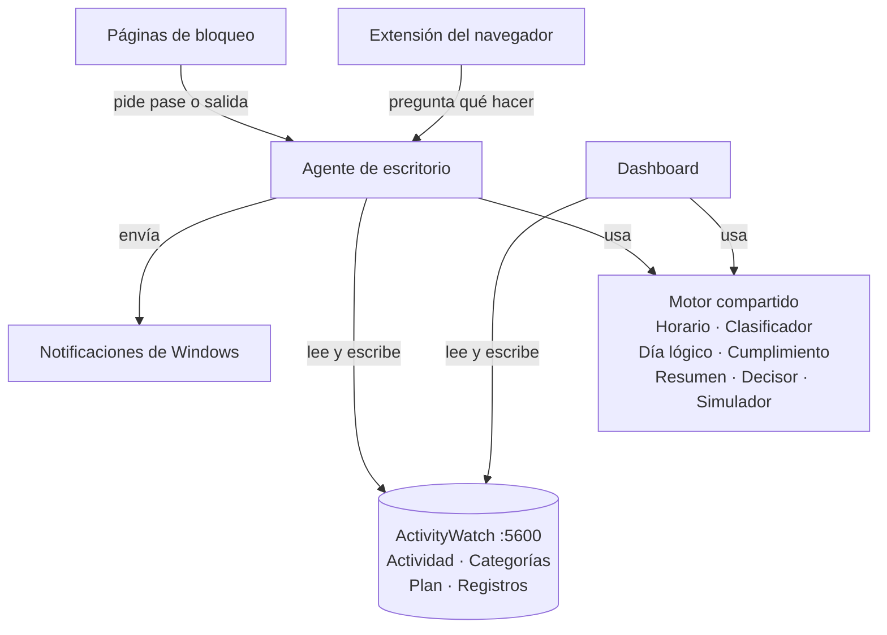

# Arquitectura — Rastreador de tiempo + modo meta

> Especificación para construir el sistema por fases con Claude Code. Las tareas, con dependencias y dificultad, están en [tareas.md](tareas.md).

## 1. Objetivo

Cumplir los horarios que Dremy se propone. Para eso el sistema:

1. Registra en qué se va el tiempo en la PC y lo clasifica (estudio, distracción, neutral).
2. Guarda su plan: horario de clases, rutinas y bloques de estudio.
3. Compara el plan con lo que de verdad pasó.
4. Durante los bloques, interviene según el nivel elegido: aviso, fricción o total.
5. Lo muestra todo en un dashboard con su propio estilo.

**Métrica principal:** % del horario cumplido, por día y por semana.

## 2. Alcance

- Una PC con Windows. Cubre toda la PC: apps de escritorio y páginas web.
- Todo local (localhost) y de uso personal.
- Fuera de alcance: el celular (ya tiene su propio bloqueo), varias PCs, nube y cuentas.
- **Sueño, fuera de alcance por ahora:** con los datos de la PC no se distingue dormir de estar lejos de la PC, así que no se muestra ninguna métrica de sueño hasta tener una fuente confiable, por ejemplo check-ins de dormir y despertar bien adoptados ([visualizaciones.md](visualizaciones.md) §3). F8-06 queda en pausa. El hueco de 3 h de §8 y §10 solo sirve para estimar el día lógico.

## 3. Principios

- **Plan contra realidad.** La distracción solo es fallo dentro de un bloque; en tiempo libre solo se mide.
- **Un solo motor.** La misma lógica decide en el simulador del dashboard y en el bloqueo real. Lo que se ve simulado es lo que pasará.
- **ActivityWatch guarda todo.** Actividad, categorías, plan (en sus ajustes) y registros propios (en buckets). No hay otra base de datos.
- **Día lógico.** El día va de despertar a dormir, no de 00:00 a 00:00.
- **Simple primero.** Sin frameworks ni paso de build en el dashboard; umbrales ajustables; cada fase deja algo usable.
- **Privacidad.** Los títulos de ventana y las URLs no salen de la PC ni se suben al repositorio.

## 4. Decisiones tomadas

| Tema | Decisión | Motivo |
|---|---|---|
| Recolección | ActivityWatch: watchers de ventana, AFK y web | Ya instalado, local, con API y lenguaje de consultas |
| Almacenamiento | Ajustes y buckets propios de ActivityWatch | Sin base de datos extra |
| Dashboard | HTML, CSS y JS con módulos ES, sin framework ni build, servido por AW en `/pages/rastreador/` | Mismo origen que la API (sin CORS) y simple de mantener |
| Gráficos | Apache ECharts como archivo local | Trae línea de tiempo, mapas de calor, calendario y gráficos radiales |
| Lógica | Motor en JS puro, compartido por el dashboard y el agente | Simulación = realidad |
| Agente | Node.js, arranca con Windows | Reutiliza el motor en JS; controla apps y notificaciones |
| Bloqueo web | Extensión Manifest V3 que consulta al agente | Bloquea por URL y muestra páginas propias |
| Niveles | Aviso, fricción y total, elegidos por bloque | Intervención escalonada |
| Clasificación | Categorías de ActivityWatch como fuente única | Las reglas se editan en un solo lugar |
| Respaldo | Exportar e importar el plan en JSON | Los ajustes viven en la base de datos de AW |

## 5. Arquitectura por capas



| Capa | Componentes | Qué hace |
|---|---|---|
| Interfaz | Dashboard, páginas de bloqueo, notificaciones | Lo que Dremy ve y usa |
| Ejecutores | Agente de escritorio, extensión del navegador | Actúan en vivo sobre apps y webs |
| Motor | Horario, Clasificador, Día lógico, Cumplimiento, Resumen, Decisor, Simulador | Solo calcula: sin pantalla, red ni reloj |
| Datos | ActivityWatch | Recolecta y guarda |

Ningún componente necesita tocar la configuración CORS de ActivityWatch: el dashboard y las páginas de bloqueo se sirven desde el propio AW (mismo origen), el agente no es un navegador y la extensión solo habla con el agente.

## 6. Componentes

### 6.1 Dashboard

- **Responsabilidad:** mostrar todo (vistas de §13), editar el plan y los niveles, registrar check-ins y correr el simulador.
- **Lee:** actividad, categorías, plan, niveles y registros (AW); estado en vivo (agente, desde la fase 6).
- **Escribe:** plan y niveles (ajustes de AW) y check-ins (bucket propio).
- **Tecnología:** HTML, CSS y JS con módulos ES; ECharts local; rutas con `#` (por ejemplo `#/hoy`), porque AW solo sirve archivos estáticos.
- **Dirección:** `http://localhost:5600/pages/rastreador/`
- **Caché:** en la memoria del navegador, los datos de los días terminados (F2-08) y sus resúmenes (§6.2); hoy siempre se recalcula. No se guarda en AW ni en disco: AW sigue siendo la única base de datos (§3).
- **Estilo:** colores, tipografía y espaciado salen solo de las variables de `css/tokens.css`. Los temas (V-10) son archivos que redefinen **esas mismas variables**; el resto del CSS no cambia. La paleta y la tipografía finales las decide Dremy (§17).

### 6.2 Motor (lógica compartida)

Módulos puros: no usan DOM, red ni el reloj del sistema. "Ahora" y los datos entran por parámetros. Cada función tiene pruebas. Las firmas exactas y la forma de los datos están en §6.7.

| Módulo | Entrada | Salida |
|---|---|---|
| Horario | Plan + fecha | Bloques concretos del día lógico |
| Clasificador | Eventos de AW, o una actividad suelta (app + título) | Segmentos clasificados; huecos como AFK o Sin PC |
| Día lógico | Segmentos + check-ins | Inicio y fin del día, horas despierto |
| Cumplimiento | Bloques + segmentos + check-ins + umbrales | Estado por bloque, % del día y de la semana, horas por curso y por área |
| Resumen | `resumirDia(segmentos, plan, checkins, dia)`; `agregarPeriodo(resumenes, desde, hasta)` | Todas las métricas de un día lógico; totales, promedios, mediana, desviación estándar, rachas y comparación de un período, sumando resúmenes diarios sin releer eventos ([visualizaciones.md](visualizaciones.md) §1 y §3) |
| Decisor | Actividad + bloque activo + nivel + pases + avisos acumulados | Acción: permitir, aviso, fricción o bloqueo |
| Simulador | Segmentos de un día + plan + nivel | Intervenciones simuladas y minutos que se habrían cortado |

### 6.3 Agente de escritorio

- Proceso Node.js que arranca al iniciar sesión en Windows y siempre está encendido.
- **Funciones:** recordatorios del horario, check-in al despertar, control de apps según el nivel, decisiones para la extensión y un latido para detectar si se apagó.
- **Lee:** plan, niveles y categorías de AW (cada minuto); la ventana activa y los procesos directamente de Windows, porque AW guarda los datos con hasta ~10 s de retraso.
- **Escribe:** sesiones, intervenciones y latido (buckets propios).
- **API local:** solo en `127.0.0.1`, puerto propio (propuesto: 5650). Responde CORS solo a los orígenes del dashboard (`http://localhost:5600` y `http://127.0.0.1:5600`, que para el navegador son distintos) y a la extensión.

### 6.4 Extensión del navegador

- Manifest V3 (Chrome, Edge o Brave).
- En cada navegación pregunta al agente qué hacer (le envía la URL y el título) y, si toca, redirige a la página de bloqueo correspondiente.
- Cada 30 s envía al agente un latido con el nombre de su navegador; así el agente sabe qué navegadores tienen la extensión (§11).
- Nunca bloquea `localhost:5600` ni `127.0.0.1:5600`. Si el agente no responde, mantiene la última decisión conocida hasta el fin del bloque.

### 6.5 Páginas de bloqueo

- Viven en `web/bloqueo/`, con el mismo estilo que el dashboard.
- Aviso, fricción, total y salida de emergencia. Muestran el bloque, el tiempo restante y el "por qué" que Dremy escribió al planificarlo.
- Las usan la extensión (webs) y el agente (apps, abriéndolas en el navegador).

### 6.6 ActivityWatch

Ya instalado. Watchers: ventana, AFK y web (aw-watcher-web). Detalles técnicos en §14.

### 6.7 Contratos del motor (v6)

Las firmas y las formas de esta sección son el **contrato** entre el motor, el dashboard y el agente. Están también, como JSDoc, en `web/motor/tipos.js`. Si un módulo necesita cambiarlas, se cambian primero aquí (y se anota en §19).

**Convenciones**

- **Instantes:** milisegundos desde 1970 en UTC (`number`), con los nombres `inicio`, `fin` e `instante`. **Duraciones:** segundos (nombres que terminan en `Seg`), salvo los que terminan en `Min`. **Fechas:** `'AAAA-MM-DD'`. **Horas del plan:** `'HH:MM'` en hora de Lima. **Días:** `lun mar mie jue vie sab dom`.
- **Estados** de un segmento: las clases de actividad `estudio`, `ia`, `neutral`, `distraccion` y `sin-clasificar`, y los estados `afk` y `sin-pc`.
- Ninguna función del motor lee el reloj, la red ni el DOM, ni modifica sus entradas: "ahora" entra como `ahora` (ms).
- Un archivo por módulo en `web/motor/`, con sus pruebas en `pruebas/<módulo>.test.js`.

**Funciones**

| Módulo | Funciones | Tarea |
|---|---|---|
| `tipos.js` | Constantes (`ESTADOS`, `CLASES`, `NOMBRE_ESTADO`, `DIAS_SEMANA`, `NIVELES`, `REGEX_APP_NAVEGADOR`…) y las formas de los datos | F1-09 |
| `fechas.js` | `diaDe`, `periodoDelDia`, `instanteDelPlan`, `instanteLocal`, `horaLocal`, `diaSemana`, `inicioSemana`, `periodoDe`, `periodoAnterior`, `periodoSiguiente`… | F1-09 |
| `regex.js` | `regexDeAW(texto, {ignorarMayusculas})` → `RegExp` (traduce la sintaxis de Python y Rust, con `\b` y `\w` Unicode) | F1-09 |
| `clasificador.js` | `compilarReglas`, `categorizar`, `categorizarEventos`, `claseDeCategoria` | H-01 |
| `segmentos.js` | `segmentar`, `recortarSegmentos`, `unirSegmentos`, `sumarPorEstado` | F1-05 |
| `checkins.js` | `normalizarCheckins` | F2-01 |
| `dia-logico.js` | `calcularDiaLogico` | F2-01 |
| `plan.js` | `normalizarPlan`, `validarPlan`, `planVacio`, `UMBRALES_INICIALES` | F3-01 |
| `horario.js` | `expandirDia`, `expandirRango`, `itemsEnCurso`, `proximoItem` | F3-03 |
| `contexto.js` | `asignarContexto` | F4-01 |
| `cumplimiento.js` | `evaluarBloque`, `evaluarRutina` | F4-02 |
| `porcentajes.js` | `porcentajeDia`, `porcentajeVarios`, `horasPorCurso`, `horasPorArea` | F4-03 |
| `niveles.js` | `NIVELES_INICIALES`, `configuracionVigente`, `tipoDeCambio`, `proponerCambio`, `cambiosPendientes`, `nivelDeBloque` | F4-04 |
| `rampa.js` | `RAMPA_FOCO_INICIAL`, `umbralFoco`, `umbralesDelDia`, `rampaVigente`, `rampaPendiente`, `proponerRampa`, `errorDeRampa`, `fechaDeMeta` | v6.4 |
| `decisor.js` | `decidir`, `crearEstadoIntervencion`, `registrarDecision`, `concederPase` | F4-05 |
| `simulador.js` | `simular`, `compararNiveles` | F4-06 |
| `resumen.js` | `resumirDia`, `tiempoEnClases`, `agregarPeriodo`, `METRICAS` | V-01, V-02, V-03 |
| `agrupar.js` | `agruparPor`, `filtrarSegmentos` | V-01, V-08 |

```js
// ── clasificador.js (H-01; F6-02 lo reutiliza) ──

/** Compila el ajuste `classes` de AW. Las reglas que no compilan en JS van a `errores` (la vista Clasificación las muestra).
 *  @param {ReglaAW[]} classes  @returns {ReglasCompiladas} */
export function compilarReglas(classes)

/** Categoría de AW para los datos de un evento (§7): cada regex se prueba contra todos los campos de texto de `data`
 *  (o solo los de `select_keys`); gana el mayor rango (priority, o profundidad × 10) y, en empate, la regla posterior.
 *  @param {Object<string, *>} data  ventana: {app, title}; para el agente, también url
 *  @param {ReglasCompiladas} compiladas  @returns {string[]}  ['Uncategorized'] si ninguna coincide */
export function categorizar(data, compiladas)

/** Copia de los eventos con data.$category.  @param {EventoAW[]} eventos  @returns {EventoAW[]} */
export function categorizarEventos(eventos, compiladas)

/** ['Estudio', 'Inglés'] → 'estudio'; un primer nivel desconocido → 'sin-clasificar'.  @returns {Estado} */
export function claseDeCategoria(categoria)

// ── segmentos.js (F1-05) ──

/** Datos de un día de AW → segmentos que cubren [inicio, min(fin, ahora)) sin huecos ni solapes.
 *  - Se descartan los eventos de duración 0; si dos se solapan, manda el que empezó antes y el otro se recorta.
 *  - En un navegador se copian url, dominio, audible e incognito del evento web con más solape.
 *  - Huecos: dentro de `afk` → 'afk'; dentro de `no_afk` sin ventana → 'sin-clasificar' (app null); si no → 'sin-pc'.
 *  - Los segmentos contiguos con el mismo estado, categoría, app, título y url se unen.
 *  - Con `rango.reglas`, los segmentos de navegador con URL se vuelven a categorizar con app, título y URL.
 *  @param {DatosDiaAW} datos  @param {{inicio: number, fin: number, ahora?: number, reglas?: ReglasCompiladas}} rango  @returns {Segmento[]} */
export function segmentar(datos, rango)

/** Recorta a [inicio, fin) y rellena con 'sin-pc' lo que falte.  @returns {Segmento[]} */
export function recortarSegmentos(segmentos, inicio, fin)

/** Une listas ya ordenadas de días seguidos (une los segmentos iguales que se tocan).  @returns {Segmento[]} */
export function unirSegmentos(...listas)

/** Segundos por estado, con las 7 claves.  @returns {Object<Estado, number>} */
export function sumarPorEstado(segmentos)

// ── checkins.js y dia-logico.js (F2-01, con lo de F5-02) ──

/** Eventos del bucket rastreador-checkins → check-ins ordenados por instante.  @returns {Checkin[]} */
export function normalizarCheckins(eventos, inicioDia = '04:00')

/** Día lógico de `fecha` (§10).
 *  @param {{fecha: string, segmentos: Segmento[], checkins?: Checkin[], inicioDia?: string, huecoMin?: number, ahora?: number}} entrada
 *         segmentos: los de los días de AW fecha−1, fecha y fecha+1 (los que existan), unidos
 *  @returns {DiaLogico} */
export function calcularDiaLogico(entrada)

// ── plan.js (F3-01) y horario.js (F3-03) ──

/** Plan con valores por defecto (ids de clases, colores de cursos, umbrales, listas vacías).  @returns {Plan} */
export function normalizarPlan(plan)
/** @returns {{valido: boolean, errores: Array<{ruta: string, mensaje: string}>, avisos: Array<{ruta: string, mensaje: string}>}} */
export function validarPlan(plan)
export function planVacio()          // @returns {Plan}

/** Lo planificado para el día lógico `fecha` (§8): plantilla semanal dentro del ciclo, bloques únicos,
 *  bloques terminados antes y excepciones.  @param {{inicioDia?: string}} [opciones]  @returns {ItemsDelDia} */
export function expandirDia(plan, fecha, opciones)
/** @returns {ItemsDelDia[]} uno por día del rango */
export function expandirRango(plan, desde, hasta, opciones)
/** @returns {{bloque: BloqueDia|null, clase: ClaseDia|null, rutina: RutinaDia|null}} lo que ocurre en `instante` */
export function itemsEnCurso(items, instante)
/** @param {ItemsDelDia[]} dias  @returns {{tipo: 'bloque'|'clase', item: BloqueDia|ClaseDia}|null} lo próximo que empieza después de `instante` */
export function proximoItem(dias, instante)

// ── contexto.js (F4-01), cumplimiento.js (F4-02, con lo de F5-03) y porcentajes.js (F4-03) ──

/** @param {Segmento[]} segmentos  @param {ItemsDelDia} items  @returns {SegmentoConContexto[]} */
export function asignarContexto(segmentos, items)

/** Estado de un bloque según §9.  @param {BloqueDia} bloque  @param {SegmentoConContexto[]} segmentos  del día
 *  @param {Checkin[]} checkins  del día  @param {Umbrales} umbrales
 *  @param {{ahora?: number, intervenciones?: Intervencion[]}} [opciones]  (salidas de emergencia, cuando existan)
 *  @returns {EstadoBloque} */
export function evaluarBloque(bloque, segmentos, checkins, umbrales, opciones)
/** Estado de una rutina según §9.  @param {DiaLogico} dia  @returns {EstadoRutina} */
export function evaluarRutina(rutina, segmentos, checkins, dia, umbrales, opciones)

/** % ponderado del día (§9).  @returns {PorcentajeDia} */
export function porcentajeDia(bloques, rutinas, umbrales)
/** La misma fórmula con varios días.  @param {Array<{bloques: EstadoBloque[], rutinas: EstadoRutina[]}>} dias  @returns {PorcentajeDia} */
export function porcentajeVarios(dias, umbrales)
/** Estudio dentro de los bloques de cada curso y papel "hecho".  @returns {Object<string, {bloquesSeg: number, papelSeg: number}>} */
export function horasPorCurso(segmentos, items, checkins)
/** Estudio por área, dentro y fuera de los bloques.  @returns {Object<string, number>} */
export function horasPorArea(segmentos)

// ── niveles.js (F4-04), decisor.js (F4-05) y simulador.js (F4-06) ──

export const NIVELES_INICIALES       // @type {Niveles} base de §11 y cambios = []
/** base + cambios con aplica_desde ≤ fecha, en orden.  @returns {ConfigNiveles} */
export function configuracionVigente(niveles, fecha)
/** @returns {'endurece'|'afloja'|'igual'} */
export function tipoDeCambio(ruta, antes, despues)
/** Endurecer aplica hoy; aflojar, desde el día lógico siguiente (§11).  @param {{hoy: string, ahora: number}} cuando
 *  @returns {{niveles: Niveles, aplicaDesde: string, inmediato: boolean, tipo: string}} */
export function proponerCambio(niveles, ruta, valor, cuando)
/** Cambios guardados que todavía no aplican en `fecha` ("se aplica mañana"). */
export function cambiosPendientes(niveles, fecha)
/** total si una excepción subió el bloque; si no, config.bloques[bloqueId] o el nivel del plan.  @returns {string} */
export function nivelDeBloque(bloque, config)

/** Qué hacer con una actividad (§11). Puro: no cambia el estado.  @param {EntradaDecisor} entrada  @returns {Decision} */
export function decidir(entrada)
/** @param {{comodines: number}} opciones  @returns {EstadoIntervencion} */
export function crearEstadoIntervencion(opciones)
/** Anota una decisión: cuenta avisos, escala a fricción tras `avisos_para_friccion` avisos en un bloque de estudio
 *  (nunca en clases) y no repite la intervención en curso.  @returns {{estado: EstadoIntervencion, intervenciones: Intervencion[]}} */
export function registrarDecision(estado, decision, contexto)
/** Permiso tras un aviso o pase de fricción (gasta un comodín).  @returns {{estado: EstadoIntervencion, intervenciones: Intervencion[]}} */
export function concederPase(estado, pedido)

/** Corre el Decisor sobre los segmentos de un día, con la misma máquina de estados que usará el agente.
 *  @param {{segmentos: SegmentoConContexto[], items: ItemsDelDia, config: ConfigNiveles,
 *           nivel?: 'plan'|'aviso'|'friccion'|'total', comodines?: number, politica?: PoliticaSimulada}} entrada
 *  @returns {ResultadoSimulacion} */
export function simular(entrada)
/** @returns {{aviso: ResultadoSimulacion, friccion: ResultadoSimulacion, total: ResultadoSimulacion}} */
export function compararNiveles(entrada)

// ── rampa.js (v6.4): rampa del foco ──

/** Foco para "cumplido" en el día lógico `fecha`: valor_inicial + paso_por_semana × semanas completas desde `inicio`,
 *  sin pasar de `meta`. Sin rampa vigente (o antes de su inicio), umbrales.foco_cumplido. Solo depende de la fecha.
 *  @param {Umbrales} umbrales  @param {string} fecha  @returns {number} 0 a 1 */
export function umbralFoco(umbrales, fecha)
/** Umbrales con los que se evalúa ese día (foco_cumplido = umbralFoco). resumirDia lo usa.  @returns {Umbrales} */
export function umbralesDelDia(umbrales, fecha)
/** Endurecer vale hoy; aflojar, desde el día lógico siguiente. rampa null = quitarla.  @param {{hoy: string}} cuando
 *  @returns {{umbrales: Umbrales, aplicaDesde: string, inmediato: boolean, tipo: 'endurece'|'afloja'|'igual'}} */
export function proponerRampa(umbrales, rampa, cuando)

// ── resumen.js (V-01, V-02, V-03) y agrupar.js ──

/** Todas las métricas de un día lógico.  @param {Segmento[]} segmentos  los del día lógico
 *  @param {Plan} plan  @param {Checkin[]} checkins  @param {DiaLogico} dia
 *  @param {{ahora?: number, inicioDia?: string, intervenciones?: Intervencion[]}} [opciones]  @returns {ResumenDia} */
export function resumirDia(segmentos, plan, checkins, dia, opciones)
/** Clases del día menos excepciones; con check-ins de asistencia, solo las marcadas "asistio".  @returns {number} segundos */
export function tiempoEnClases(items, checkins)
/** Suma resúmenes diarios sin releer eventos. Si `resumenes` trae también los del período anterior del mismo largo,
 *  llena `comparacion`.  @param {ResumenDia[]} resumenes  @returns {ResumenPeriodo} */
export function agregarPeriodo(resumenes, desde, hasta)
/** clave → {nombre, unidad: 'seg'|'proporcion'|'min'|'numero', tipo: 'suma'|'promedio', valor: (r: ResumenDia) => number|null} */
export const METRICAS

/** Tiempo de actividad por 'app', 'dominio', 'url', 'titulo', 'categoria' o 'area', de mayor a menor.
 *  @returns {Array<{clave: string, segundos: number, porEstado: Object<Estado, number>}>} */
export function agruparPor(segmentos, clave, opciones)
/** @param {{tipo: 'categoria'|'app'|'dominio'|'palabra', valor: string}} consulta  @returns {Segmento[]} */
export function filtrarSegmentos(segmentos, consulta)
```

**Formas de los datos** (el detalle de todas está en `web/motor/tipos.js`)

```js
/** Evento clasificado: tramo continuo con un solo estado y una sola actividad. Una lista de segmentos
 *  cubre su rango entero, ordenada, sin huecos ni solapes.
 * @typedef {Object} Segmento
 * @property {number} inicio
 * @property {number} fin                 > inicio
 * @property {Estado} clase               'estudio'|'ia'|'neutral'|'distraccion'|'sin-clasificar'|'afk'|'sin-pc'
 * @property {string[]|null} categoria    ruta de AW; null en afk y sin-pc
 * @property {string|null} area           en Estudio: categoria[1] (o 'Sin área'); si no, null
 * @property {string|null} app
 * @property {string|null} titulo
 * @property {string|null} url            solo en navegadores con datos web
 * @property {string|null} dominio        sin "www."
 * @property {boolean} audible
 * @property {boolean} incognito
 */
/** SegmentoConContexto = Segmento + { contexto: 'bloque'|'clase'|'rutina'|'libre', bloqueId, cursoId, claseId, rutinaId }
 *  (asignarContexto parte los segmentos en los bordes; si se superponen: bloque > clase > rutina > libre). */

/** Todas las métricas de un día lógico (visualizaciones §3). Tiempos en segundos.
 * @typedef {Object} ResumenDia
 * @property {string} fecha
 * @property {DiaLogico} dia               {fecha, inicio, fin, fuenteInicio, fuenteFin, cerrado, sinDatos, despiertoSeg}
 * @property {boolean} sinDatos
 * @property {number} despiertoSeg
 * @property {number} activoSeg            las 5 clases de actividad
 * @property {Object<Estado, number>} porEstado      las 7 claves; suman despiertoSeg
 * @property {Object<string, number>} porArea        Estudio por área
 * @property {Object<string, number>} porCategoria   'Distracción > Video' → seg (solo actividad)
 * @property {Object<string, {bloquesSeg: number, papelSeg: number}>} porCurso   todos los cursos del plan
 * @property {number} clasesSeg            tiempo en clases (V-03)
 * @property {number} papelSeg             bloques estudio_papel con check-in "hecho"
 * @property {number} estudioTotalSeg      porEstado.estudio + papelSeg
 * @property {Array<{estados: Object, areas: Object, cursos: Object}>} porHora   24 horas locales; ninguna pasa de 3600
 * @property {string[]} tramos             96 tramos de 15 min: 'clase' o el estado dominante; fuera del día lógico, 'sin-pc'
 * @property {string[]} tramosPlan         96 tramos: 'bloque' | 'clase' | 'rutina' | 'libre'
 * @property {number} cambiosApp
 * @property {number|null} cambiosPorHora  por hora activa
 * @property {{inicio: number, fin: number, seg: number}|null} focoMasLargo   Estudio continuo (tolera cortes < 2 min)
 * @property {EstadoBloque[]} bloques      estado, foco, retrasoMin, estudioSeg, distraccionSeg, motivo…
 * @property {EstadoRutina[]} rutinas      estado, pesoSeg, logradoSeg, horaReal, horaObjetivo, motivo…
 * @property {PorcentajeDia} cumplimiento  {porcentaje (0 a 1 o null), cumplido, pesoSeg, medibles}
 * @property {number|null} retrasoMedioMin
 * @property {Object<string, number>} porApp
 * @property {Object<string, number>} porDominio
 */

/** Un período (semana, mes o rango), calculado sumando resúmenes diarios.
 * @typedef {Object} ResumenPeriodo
 * @property {string} desde
 * @property {string} hasta
 * @property {number} dias
 * @property {number} diasConDatos
 * @property {string[]} fechasSinDatos
 * @property {Object<string, Estadistico>} metricas   una por clave de METRICAS:
 *           {total, promedio (días con datos), promedioConVacios, mediana, max: {valor, fecha}, min: {valor, fecha}, desviacion}
 * @property {Object} totales              porEstado, porArea, porCurso, porCategoria, porApp, porDominio, clasesSeg, papelSeg
 * @property {Object<string, Object<string, number|null>>} porDiaSemana   'lun' → métrica → promedio
 * @property {{diaCumplido: Racha, rutinas: Object<string, Racha>}} rachas   Racha = {actual, mejor}
 * @property {PorcentajeDia} cumplimiento  la fórmula del día con todos los días
 * @property {{desde, hasta, metricas: Object<string, {actual, anterior, diferencia}>}|null} comparacion
 *           con el período anterior del mismo largo; 'suma' compara totales y 'promedio', promedios
 */
```

Las demás formas (`EventoAW`, `DatosDiaAW`, `ReglaAW`, `ReglasCompiladas`, `Checkin`, `DiaLogico`, `Plan`, `ItemsDelDia`, `BloqueDia`, `ClaseDia`, `RutinaDia`, `EstadoBloque`, `EstadoRutina`, `PorcentajeDia`, `Niveles`, `ConfigNiveles`, `Actividad`, `Decision`, `EstadoIntervencion`, `Intervencion`, `PoliticaSimulada`, `ResultadoSimulacion` y `DiaCompleto`) están en `web/motor/tipos.js`.

**Día lógico (algoritmo de `calcularDiaLogico`, §10)**

- **Actividad** = segmentos de las 5 clases (no AFK ni Sin PC). Un **hueco** es una racha sin actividad, incluidas las que tocan el principio o el final de los datos: antes de la primera actividad el hueco empieza en −∞, y después de la última termina en +∞ si ya pasaron `huecoMin` desde ella (si no, la persona puede seguir activa y ese hueco todavía no existe).
- **Límite de un inicio de día de AW** `S` (las 04:00 de una fecha): de los huecos de al menos `huecoMin` que tocan la ventana [`S` − 8 h, `S` + 8 h], el que **contiene** `S`; si ninguno lo contiene, el más cercano a `S`; si empatan, el más largo. Su borde izquierdo es el fin del día anterior y el derecho, el inicio del día. Así la actividad de la 1:00 a. m. es del día anterior, una trasnoche que pasa de las 04:00 sin hueco de 3 h también, y el hueco de una clase presencial a media mañana no le gana a una noche corta.
- **Inicio:** check-in de despertar → límite de `S(fecha)` (si su inicio cae antes de `S(fecha + 1)`) → `S` (`fuenteInicio` = `'inicio_dia'`).
- **Fin:** check-in de dormir → límite de `S(fecha + 1)` → si el día sigue (hoy): `ahora`, o la última actividad si ya pasaron `huecoMin` → `S(fecha + 1)`.
- **Sin datos:** si con esos dos límites no queda actividad en [inicio, fin) (o fin ≤ inicio), el día es `sinDatos`, con `inicio` = `fin` = `S` (o la hora del check-in de despertar). Si ese día tiene check-ins de despertar **y** de dormir, va de despertar a dormir: sigue siendo `sinDatos` (no hubo PC), pero con sus horas despierto, todas Sin PC. El día nunca dura más de 24 h.
- `huecoMin` lo calcula quien llama: `plan.umbrales.hueco_sueno_h × 60`.

**Flujo de un día en el dashboard** (`web/js/datos.js`, F2-09)

1. El almacén de F2-08 da los `DatosDiaAW` de cada día de AW (caché de los días terminados).
2. Para el día `D` se piden `D − 1`, `D` y `D + 1`; se segmenta cada uno y se unen.
3. `calcularDiaLogico` → `DiaLogico`; `recortarSegmentos` al día lógico.
4. `expandirDia` → `ItemsDelDia`; `asignarContexto`; `resumirDia` → `ResumenDia`.
5. Los resúmenes de días terminados y `cerrado` quedan en caché en la memoria (§6.1); se vacía si cambian el plan o los check-ins.

Las vistas **leen y guardan** datos solo con `web/js/datos.js`; para calcular pueden importar funciones puras del motor (`simular`, `agregarPeriodo`, `compararPeriodos`, `agruparPor`, `validarPlan`, `proponerCambio`, `expandirRango`…):

| Función | Devuelve |
|---|---|
| `datos.hoy()` | Fecha del día lógico actual según el reloj (H-02) |
| `datos.dia(fecha)` | `DiaCompleto`: `{fecha, esHoy, dia, segmentos (con contexto), items, resumen, checkins, plan, config}` |
| `datos.resumenes(desde, hasta)` | `ResumenDia[]`, uno por día |
| `datos.segmentos(desde, hasta)` | `[{fecha, segmentos}]` (para el explorador y Clasificación) |
| `datos.plan()`, `datos.guardarPlan(plan)` | Plan normalizado; guardar valida antes y vacía la caché |
| `datos.niveles()`, `datos.guardarNiveles(n)` | Ajuste `rastreador-niveles` |
| `datos.checkins(desde, hasta)`, `datos.registrarCheckin(c)`, `datos.borrarCheckin(id)` | Check-ins (bucket propio); `registrarCheckin` guarda siempre `fecha` |
| `datos.intervenciones(desde, hasta)` | Intervenciones reales del agente (vacía hasta la fase 6); `DiaCompleto.intervenciones` trae las del día |
| `datos.reglas()` | `{classes, compiladas}` (reglas de AW y las que no compilan) |
| `datos.estadoAW()` | `{conectado, version, hostname, buckets}` |

**Reglas entre módulos** (revisión de F1-09)

- **Día sin datos y `no_medible`:** despertar y dormir son `no_medible` si su hora sale de `'inicio_dia'` o `'sin_datos'`. Lo que se mide en la PC (bloques `estudio_pc` y `examen`, rutinas `pc`) en un día sin datos ya terminado es `fallido` ("no empezó"); lo que va por check-in (papel, rutinas `checkin`) se evalúa igual que siempre. Un día sin datos entra al % del período (y puede cortar rachas), pero sus métricas no entran a los promedios "por día con datos".
- **Check-ins:** despertar = `instanteLocal(fecha, valor)`; dormir = el primer instante con esa hora después del inicio del día lógico (o de `S`); si hay varios del mismo tipo y fecha, manda el de mayor `instante`; en despertar y dormir el `refId` no importa.
- **Bloque terminado antes:** el foco y el peso en el % usan la duración **planificada** (terminar antes no mejora el foco); el contexto `'bloque'` llega solo hasta el fin real.
- **"Ahora":** `datos.js` pasa siempre la hora actual. Un día en curso (no `cerrado`) entra en los totales, pero no corta rachas.
- **Resumen:** `resumirDia` hace `expandirDia` y `asignarContexto` adentro (son baratos) y acepta `opciones.items` si ya están calculados. `agregarPeriodo(resumenes, desde, hasta, {umbrales})` y `compararPeriodos(actual, anterior)` → `ComparacionPeriodo` (lo usan V-05 y V-09). El período anterior de un mes es el mes calendario anterior.
- **`METRICAS`:** claves `estudio`, `estudioTotal`, `papel`, `clases`, `ia`, `neutral`, `distraccion`, `sinClasificar`, `activo`, `afk`, `sinPc`, `despierto`, `cumplimiento`, `retraso`, `cambiosPorHora`, `focoMasLargo`, `despertar` y `dormir` (minutos locales; `dormir` suma 1440 si pasa la medianoche). "Con datos" = día sin `sinDatos` y valor distinto de `null`. El cumplimiento de un período es el ponderado de §9 con todos sus días, no el promedio de los %.
- **Clases:** id `c-<curso>-<días unidos>-<HHMM>`, con `-2`, `-3`… si se repite. **Asistencia** clase por clase: una clase con check-in `falto` no cuenta como tiempo en clases; con `asistio` o sin check-in, sí.
- **Excepciones superpuestas:** cancelar gana a subir a total.
- **Categoría de las webs:** AW categoriza el evento de ventana (app y título), como su vista Actividad. Cuando un segmento de navegador tiene URL, `segmentar` (con `rango.reglas`, que `datos.js` le pasa) vuelve a categorizarlo con app, título **y URL**, igual que hará el agente: así una regla de URL (por ejemplo `youtube\.com/shorts/` → Distracción > Video > Shorts) cuenta en el dashboard y en el simulador. Sin URL (navegador sin `aw-watcher-web`) vale la categoría de la ventana. Por eso los totales del dashboard pueden diferir de la vista Actividad de AW en lo que cambian las reglas de URL.
- **Navegadores sin la extensión:** `Actividad` puede traer `esNavegador` y `conExtension`; en el simulador, un navegador con `url = null` cuenta como sin extensión. En nivel total se bloquea con el motivo `'sin_extension'` (§11).
- **Nombres:** lo que se guarda en AW (plan, niveles, check-ins, intervenciones) va en snake_case, como en §8 y §12; lo que calcula el motor, en camelCase.

### 6.8 Herramientas de desarrollo

- **AW falso** (`herramientas/aw-falso.js`, H-01): `node herramientas/aw-falso.js [--puerto 5600]`, o `npm run aw-falso` (puerto 5655, para no chocar con el AW real). Sirve las rutas de `/api/0` que usa el dashboard con los datos de `datos-ejemplo/` y `web/` en `/pages/rastreador/` (mismo origen, como el AW real). `classes` sale de `datos-ejemplo/clases-ejemplo.json` y `rastreador-plan` arranca con `plan-ejemplo.json`. Lo que se guarda (ajustes, check-ins) vive solo en la memoria del proceso. No interpreta el lenguaje de consultas: reconoce la consulta canónica de `web/js/consultas.js` y la resuelve en JS.
- **Reloj de prueba** (`web/js/reloj.js`, H-02): con `?ahora=AAAA-MM-DDTHH:MM` antes del `#` (hora de Lima), el dashboard arranca en ese momento y el reloj sigue corriendo; por ejemplo, `http://localhost:5600/pages/rastreador/?ahora=2026-10-14T16:20#/hoy`. Solo para probar con los datos de ejemplo.
- **Capturas** (`herramientas/capturas.mjs`, H-03): con Playwright (opcional, no es una dependencia del proyecto), toma capturas de cada vista en claro y oscuro, a 1366×768 y a 1920×1080, contra el AW falso.

## 7. Clasificación

**Clases** = primer nivel del árbol de categorías de AW.

| Clase | Subcategorías (segundo nivel) |
|---|---|
| Estudio | Una por **área**: Programación, Matemáticas, Inglés, Humanidades |
| Distracción | Video, Redes, Juegos, Otros |
| Neutral | Comunicación, Sistema, Otros (aquí van YouTube, Spotify y Obsidian) |
| IA | Sin subcategorías: asistentes y herramientas de IA (Claude, ChatGPT, Gemini, Antigravity…) |
| Sin clasificar | Lo que ninguna regla reconoce (Uncategorized en AW) |

- **Áreas, no cursos.** Los cursos cambian cada ciclo; las áreas no. Los cursos viven en el plan (§8) y cada uno apunta a un área. Así, cambiar de ciclo no obliga a tocar las categorías de AW.
- **IA** es una clase aparte para medir el uso de IA. No cuenta como foco (§9) y no se bloquea en ningún nivel (§11). Su regla lleva prioridad 30, así que gana siempre, aunque el título tenga palabras de un área (por ejemplo, una conversación sobre integrales cuenta como IA).
- **YouTube** está en Neutral porque se usa para todo (música, clases, inglés, ejercicios, distraerse). Si el título trae palabras de un área, gana Estudio: tiene el mismo rango (20) y va después en la lista.
- **Shorts de YouTube** son Distracción (decisión de Dremy, 2026-11-10): una regla de URL `youtube\.com/shorts/` en `Distracción > Video > Shorts` (profundidad 3 → rango 30; la IA va después en la lista y sigue ganando). Solo coincide donde hay URL (ver "Categoría de las webs" en §6.7). En el repo está en `datos-ejemplo/clases-ejemplo.json`; las reglas reales las carga Dremy en AW.
- Las terminales (Warp, Windows Terminal, PowerShell…) van en Estudio > Programación.

**Estados** (no son categorías): **AFK** = PC encendida sin uso; **Sin PC** = no hay datos (apagada o suspendida).

**Contexto** de cada segmento según el plan: en bloque de estudio, en clase, en rutina o libre.

**Reglas**

- Se editan en ActivityWatch (Ajustes → Categorización) y se leen del ajuste `classes`.
- Son regex que se prueban contra **todos los campos de texto** de `data` del evento: la app y el título en los eventos de ventana, y también la URL en los eventos del navegador (así lo hace `classify.rs` cuando la regla no trae `select_keys`). Por eso el clasificador en vivo del agente recibe app, título y, si es una web, la URL que le manda la extensión.
- Si varias coinciden, gana la de mayor rango: su prioridad si la tiene; si no, profundidad × 10 (la más profunda). En empate gana la que va **después** en la lista. El servidor Python (`aw-core/aw_transform/classify.py`) y el de Rust aplican el mismo criterio.
- Para bloquear por ruta (por ejemplo `youtube.com/shorts`) hay patrones de URL extra en los niveles (§11).
- **URLs visibles:** el dashboard muestra la URL completa de cada página web, en el detalle de la línea de tiempo y en los más usados (agrupados por dominio, con sus URLs), para ver exactamente en qué se estuvo. Es solo local: las URLs no salen de la PC (§3).

## 8. Plan: horario de clases y rutinas

Se guarda en el ajuste `rastreador-plan` de AW y se puede exportar e importar en JSON.

**Ciclo:** nombre (2026-2), fecha de inicio y fecha de fin.

**Cursos**

| Campo | Descripción | Ejemplo |
|---|---|---|
| id | Identificador corto | bd1 |
| nombre | Nombre visible | BD I |
| area | Área de Estudio en AW a la que pertenece (§7) | Estudio > Programación |
| color | Color del curso: un token de `tokens.css` (`curso-1` a `curso-8`) | curso-2 |
| meta_horas_semana | Horas de estudio propio por semana | 6 |
| prioridad | Alta, media o baja | Media |

**Clases:** id, curso, tipo (teoría o laboratorio), días, inicio, fin, lugar y `usa_pc` (sí o no). Si falta el id, el motor pone `c-<curso>-<días>-<HHMM>` (los check-ins de asistencia lo usan).

**Rutinas**

| Campo | Descripción |
|---|---|
| id, nombre | Por ejemplo: ejercicio, inglés, despertar |
| dias, inicio, fin | Ventana en la que se espera. `inicio` y `fin` son **opcionales**: sin ellos, la rutina cuenta en cualquier momento del día lógico (de despertar a dormir) |
| medicion | `pc` (minutos de una categoría), `checkin` (sí o no) o `dia_logico` (despertar y dormir) |
| evento | Solo en `dia_logico`: `despertar` o `dormir` (si falta, se deduce del id o del nombre). La hora objetivo es `inicio` |
| categoria, minutos_meta | Solo si la medición es `pc` |
| tolerancia_min | Margen antes de contar como tarde |

**Bloques de estudio**

| Campo | Descripción |
|---|---|
| id | Identificador |
| tipo | `estudio_pc`, `estudio_papel` o `examen` |
| curso | Curso del bloque |
| repeticion | Semanal (días) o única (fecha) |
| inicio, fin | Horas (si `fin` < `inicio`, el bloque cruza la medianoche) |
| terminados_antes | Lista de `{fecha, fin, motivo}`: el día en que se terminó antes, la hora real y su motivo |
| nivel | Ninguno, aviso, fricción o total |
| objetivo | Qué vas a hacer |
| por_que | Motivo; se muestra en las páginas de bloqueo |

**Bloques después de medianoche:** las horas del plan pertenecen al día del plan. Si un bloque empieza antes del `startOfDay` de AW (04:00), ocurre en la madrugada del día calendario siguiente. Ejemplo: "lunes 00:30–01:30" es la noche del lunes (martes a las 00:30), igual que en el día lógico.

**Excepciones:** desde, hasta, tipo (feriado, exámenes o libre) y efecto (cancelar clases y bloques, subir los bloques a total o cancelar bloques). Las excepciones cancelan clases y bloques **semanales**; los bloques únicos (con fecha puesta a mano, como los de "Empezar bloque ahora") no se cancelan, pero sí suben a total. Si dos excepciones cubren el mismo día, cancelar gana a subir.

**Umbrales** (ajustables)

| Umbral | Valor inicial |
|---|---|
| Tolerancia de inicio | 10 min |
| Foco para "cumplido" | 70 % |
| Foco para "parcial" | 40 % |
| Día cumplido | 80 % |
| Hueco que cuenta como sueño | 3 h |
| Peso de despertar y de dormir | 30 min cada uno |

**Rampa del foco** (opcional; propuesta de Dremy, v6.4). Para formar el hábito, el foco para "cumplido" puede empezar bajo y subir cada semana: `{inicio, valor_inicial, meta, paso_por_semana}`, por defecto 40 % → 70 % a +4 puntos por semana (llega en 8 semanas).

- El umbral de un día = `valor_inicial` + `paso_por_semana` × semanas completas desde `inicio`, sin pasar de `meta` (`umbralFoco` en `web/motor/rampa.js`). **Solo depende de la fecha:** no retrocede si un día o una semana sale mal.
- **Cada día se evalúa con el umbral de su fecha.** Por eso el plan no guarda una sola rampa sino sus versiones: `umbrales.rampas_foco` = lista de `{aplica_desde, rampa}` (`rampa` = `null` para quitarla); vale la última con `aplica_desde` ≤ fecha. Cambiar la rampa no reescribe los días pasados.
- Sin rampa vigente, o antes de su `inicio`, vale el `foco_cumplido` fijo. Si la rampa deja el foco de "cumplido" por debajo del de "parcial", el de "parcial" baja con él ese día.
- **Asimetría (como en §11):** un cambio que pide más foco algún día y nunca menos vale desde hoy; si pide menos algún día de aquí en adelante (activar una rampa más baja que el fijo, bajar el paso, empezar de nuevo), queda pendiente hasta el día lógico siguiente (`proponerRampa`). Se configura en Ajustes.

## 9. Reglas de cumplimiento

| Tipo | Cumplido | Parcial | Fallido |
|---|---|---|---|
| Estudio en PC y examen | Empieza a tiempo, foco ≥ 70 % y sin salida de emergencia | Foco entre 40 y 70 %, o empieza tarde | Foco < 40 %, no empieza o usa la salida de emergencia |
| Estudio en papel | Check-in "hecho" y sin distracción en la PC | "Hecho", pero con distracción en la PC | "No hecho" o sin check-in |
| Rutina `pc` | Llega a sus minutos dentro de la ventana | Al menos 50 % de los minutos | Menos del 50 % |
| Rutina `checkin` | "Hecho" | — | "No hecho" o sin check-in |
| Despertar y dormir | Hora real ≤ objetivo + tolerancia | Hasta el doble de la tolerancia | Más tarde |

- **Clases:** no cuentan para el %; son contexto. Si `usa_pc` = sí, se aplican avisos, y en clase el nivel se queda siempre en aviso: no escala (§11).
- **Foco** = minutos de Estudio (cualquier área) dentro del bloque ÷ duración del bloque. Los minutos de IA no cuentan como foco. El 70 % de "cumplido" es el valor fijo; con la rampa del foco (§8) es el umbral de la fecha de ese día.
- **Horas por curso** = minutos de Estudio dentro de los bloques de ese curso (el bloque sabe su curso). Fuera de los bloques solo hay **horas por área**, porque dos cursos pueden compartir área. La meta semanal de cada curso se mide con sus bloques.
- **Puntualidad** = minutos entre el inicio planificado y el primer minuto de Estudio.
- **% del día** = Σ(peso × duración planificada) ÷ Σ(duración planificada), con peso 1 (cumplido), 0,5 (parcial) y 0 (fallido). Solo entran bloques y rutinas medibles.
- **% de la semana** = la misma fórmula con todos sus días.
- **Días sin datos, bloques terminados antes y estados `pendiente` / `no_medible`:** ver las reglas entre módulos de §6.7.

## 10. Día lógico y horas despierto

- **Inicio:** check-in de despertar. Si no hay, la primera actividad (no AFK) después del último hueco de 3 h o más. Si tampoco hay, el "inicio del día" de AW (ajuste `startOfDay`, 04:00 por defecto). El algoritmo exacto (qué hueco cuenta) está en §6.7.
- **Fin:** check-in de dormir. Si no hay, la última actividad antes del siguiente hueco de 3 h o más.
- **Horas despierto** = ahora − inicio (hoy) o fin − inicio (días pasados).
- **Reparto de las horas despierto:** estudio, distracción, neutral, IA, sin clasificar, AFK y sin PC. Siempre suma las horas despierto.
- **Zona horaria:** America/Lima (UTC−5, sin horario de verano).
- **Ejemplo:** la actividad de la 1:00 a. m. cuenta para el día lógico anterior.

## 11. Niveles de bloqueo

| Nivel | Webs | Apps | Para seguir | Se registra |
|---|---|---|---|---|
| Aviso | Página de aviso con "continuar" | Notificación de Windows | Un clic: permiso de 5 min para ese sitio o app | `aviso` |
| Fricción | Página con espera de 60 s y motivo obligatorio | Se minimiza o se cierra, y se abre la página de fricción | Pase de 10 min que gasta 1 comodín (5 por semana) | `friccion` y `pase`, con motivo |
| Total | Página de bloqueo sin pase | Se cierra al abrirse; también los navegadores sin la extensión | Solo la salida de emergencia: espera de 10 min y una frase; el bloque queda fallido | `bloqueo` y `salida_emergencia` |

- **Qué se bloquea:** en aviso y fricción, la clase Distracción y los patrones de URL extra; en total, además, lo Sin clasificar (configurable). La IA no se bloquea en ningún nivel.
- **Nunca se bloquea:** el dashboard y las páginas de bloqueo (en `localhost:5600` y en `127.0.0.1:5600`), el agente, ActivityWatch, los procesos del sistema y la lista `nunca_bloquear`.
- **Navegadores sin la extensión:** un navegador abierto cuyo latido (§6.4) no llegó en el último minuto cuenta como "sin extensión".
- **Escalamiento:** 3 avisos en un mismo bloque de estudio lo suben a fricción. En las clases no hay escalamiento: siempre aviso.
- **Asimetría:** endurecer es inmediato; aflojar (bajar un nivel, quitar algo de una lista, sumar comodines, **cambiar la frase de la salida de emergencia**) queda pendiente hasta el día lógico siguiente.
- **Cambios pendientes:** cada cambio se guarda en `rastreador-niveles` con `aplica_desde` (fecha del día lógico en que entra en vigor). Nadie lo "activa": el motor calcula la configuración vigente a partir de "ahora" y del día lógico. Así el dashboard y el agente no se pisan escribiendo el mismo ajuste.
- **Nivel de cada bloque:** el plan guarda el nivel inicial; los cambios posteriores van a `rastreador-niveles` (`bloques.<id del bloque>`), con la misma asimetría. Una excepción que sube los bloques a total gana siempre.
- Los valores (5 min, 60 s, 10 min, 5 comodines) viven en el ajuste `rastreador-niveles`.

## 12. Registros propios en ActivityWatch

Convención de AW para buckets: `<nombre>_<hostname>`. Todos los buckets propios usan `client` = `rastreador`.

| Bucket | Qué guarda | Campos de `data` |
|---|---|---|
| `rastreador-sesiones_<host>` | Inicio y fin reales de cada bloque | bloque_id, tipo, curso, nivel_inicial, nivel_final, estado, terminado_antes, motivo |
| `rastreador-intervenciones_<host>` | Cada aviso, fricción, bloqueo, pase, escalamiento o salida de emergencia | bloque_id (id del bloque del día, `<id>@<fecha>`), clase_id, nivel, accion, objetivo (app o web), app, url, titulo, motivo |
| `rastreador-checkins_<host>` | Despertar, dormir, rutina, estudio en papel, asistencia | tipo, ref_id, valor, nota y `fecha` (día lógico al que se refiere; si falta, el día de AW del timestamp). `valor`: `HH:MM` en despertar y dormir, `hecho` o `no_hecho` en rutina y papel, `asistio` o `falto` en asistencia |
| `rastreador-agente_<host>` | Latido del agente cada minuto | estado |

| Ajuste de AW | Contenido |
|---|---|
| `rastreador-plan` | Ciclo, cursos, clases, rutinas, bloques, excepciones y umbrales |
| `rastreador-niveles` | Valores de cada nivel, listas y cambios pendientes |

Las simulaciones no se guardan: se recalculan.

## 13. Vistas del dashboard

| Vista | Qué muestra | Fases |
|---|---|---|
| Hoy | Despierto desde y horas despierto; bloque actual con cuenta regresiva y el siguiente; botón "Empezar bloque ahora"; línea de tiempo de 24 h con carriles Plan, Real e Intervenciones (el detalle de cada segmento web muestra la URL completa); reparto de las horas despierto; totales por clase, por área y por curso; cumplimiento del día; panel en vivo del agente | 1 a 6 |
| Horas del día | Barras por hora (0 a 23) por clase; mapa de calor hora × día de la semana; reloj de 24 h | 2 |
| Horario | Editor de ciclo, cursos, clases, rutinas, bloques y excepciones; planificador semanal | 3 |
| Cumplimiento | Calendario de días cumplidos; puntualidad; % de foco por bloque; horas por curso contra la meta y horas por área; rachas por rutina | 4 y 5 |
| Simulador | Eliges día y nivel: intervenciones simuladas, minutos cortados y comparación de los 3 niveles | 4 |
| Clasificación | Apps y sitios más usados por clase (los sitios agrupados por dominio, con sus URLs completas); lo más usado sin clasificar; qué bloquea cada nivel; reglas que no compilan | 2, 4 y 6 |
| Diario | Check-ins e intervenciones con su motivo; revisión semanal | 5 y 8 |
| Ajustes | Niveles, umbrales, exportar e importar, estado de AW y del agente | 3 y 4 |
| Resumen del período | KPIs con comparación, barras apiladas por día con meta, estudio con media móvil de 7 días, horas por curso contra la meta, calendario mensual, día de la semana promedio | V |
| Día típico | Franja de 24 h en tramos de 15 min con el estado más frecuente del período, y debajo la franja del plan | V |
| Explorador de actividad | Una categoría, app, dominio o palabra: serie diaria, horas del día y URLs y títulos más frecuentes | V |
| Comparar | Dos períodos lado a lado con sus diferencias | V |

Todas las vistas usan un **selector de período** común (Día, Semana, Mes o Rango, con flechas), que amplía el selector de fecha de F2-08. Las métricas, los promedios y los gráficos de cada vista se detallan en [visualizaciones.md](visualizaciones.md).

## 14. Referencia técnica de ActivityWatch

**API** (base `http://localhost:5600/api/0`)

| Uso | Endpoint |
|---|---|
| Versión y hostname | `GET /info` |
| Listar buckets | `GET /buckets/` |
| Crear bucket | `POST /buckets/<id>` (client, type, hostname) |
| Leer eventos | `GET /buckets/<id>/events?start=&end=&limit=` |
| Insertar eventos | `POST /buckets/<id>/events` |
| Latido | `POST /buckets/<id>/heartbeat?pulsetime=<s>` (pulsetime es obligatorio) |
| Borrar un evento | `DELETE /buckets/<id>/events/<event_id>` |
| Consultas | `POST /query/` con `timeperiods` (intervalos "inicio/fin" en RFC 3339) y `query` (lista de sentencias) |
| Ajustes | `GET /settings/`, y `GET` o `POST /settings/<clave>` |

- **Evento:** `timestamp` (ISO 8601), `duration` (segundos) y `data` (objeto). Los eventos categorizados traen `data.$category` (la ruta como lista).
- **Funciones de consulta útiles:** `query_bucket`, `find_bucket`, `flood`, `filter_keyvals`, `filter_period_intersect`, `period_union`, `union_no_overlap`, `merge_events_by_keys`, `categorize`, `split_url_events`, `sum_durations`, `sort_by_duration`, `concat`.
- **Consulta canónica de referencia:** `canonicalEvents` en `aw-webui/src/queries.ts` (ventana sin AFK, navegador y categorías). `categorize` recibe las reglas como pares [ruta, regla], como las arma `classes_for_query` en `aw-webui/src/stores/categories.ts`.
- **Criterio de categorización de AW:** `aw-server-rust/aw-transform/src/classify.rs`.
- **Buckets de AW:** `aw-watcher-window_<host>`, `aw-watcher-afk_<host>` y `aw-watcher-web-<navegador>_<host>`.
- **Ajustes de AW que se leen:** `classes` (categorías efectivas), `startOfDay` (04:00) y `always_active_pattern`.
- **Retraso:** los watchers envían a AW cada ~10 s. Para decisiones en vivo, el agente lee Windows directamente.
- **Caché:** AW v0.14 cachea las consultas de días terminados; conviene pedir los datos día por día.
- **Herramientas de AW:** Query Explorer (`#/query`) para probar consultas; Asistente de categorización (`#/category-builder`).

**Configuración del servidor** (la carpeta también se abre desde el ícono de AW en la bandeja)

| | App clásica (servidor Python, predeterminada) | App Tauri (servidor Rust) |
|---|---|---|
| Archivo | `%LOCALAPPDATA%\activitywatch\activitywatch\aw-server\aw-server.toml` | `%LOCALAPPDATA%\activitywatch\aw-server-rust\config.toml` |
| Servir el dashboard | Sección `[server.custom_static]` con `rastreador` = ruta a `web/` | Sección `[custom_static]` con la misma entrada |
| CORS (no hace falta aquí) | `cors_origins` | `cors` y `cors_regex` |

- Hay que reiniciar AW después de editar la configuración.
- **Tipo MIME de `.js` (servidor Python):** el servidor toma el tipo de archivo del registro de Windows. Si ahí `.js` figura como `text/plain`, el navegador rechaza los módulos ES. La prueba de F0-05 importa un módulo para detectarlo; la solución es poner `Content Type` = `text/javascript` en la clave `HKEY_CLASSES_ROOT\.js` del registro.
- `/pages/rastreador/` recibe `hostname`, `start`, `end` y `title` cuando se incrusta como visualización personalizada en la vista Actividad de AW.
- Para saber qué servidor corre: `GET /info`. Si la versión termina en "(rust)", es el de Rust.

## 15. Estructura del repositorio

- `web/` — servido por AW en `/pages/rastreador/`
  - `index.html` — dashboard
  - `css/` — `tokens.css` (colores, tipografía, espaciado), `temas/` (V-10: redefinen las variables de `tokens.css`), `vistas/` (estilos de cada vista) y estilos generales
  - `js/` — vistas, componentes, cliente de AW, servicio de datos (`datos.js`), reloj (`reloj.js`) y cliente del agente
  - `motor/` — lógica compartida por el dashboard y el agente; un archivo por módulo de §6.7
  - `bloqueo/` — páginas de aviso, fricción, total y salida de emergencia
  - `lib/` — ECharts
- `package.json` — en la raíz, con `"type": "module"` (para que Node cargue `web/motor/` y las pruebas como módulos ES) y el script `test` (`node --test`). Sin dependencias.
- `agente/` — Node.js; importa `web/motor/`
- `extension/` — Manifest V3
- `herramientas/` — AW falso (`aw-falso.js` y `aw-falso/`, H-01), capturas (`capturas.mjs`, H-03) y exportación anonimizada (§6.8)
- `pruebas/` — pruebas del motor (test runner de Node); `pruebas/ayudantes/` lee `datos-ejemplo/`
- `datos-ejemplo/` — datos sintéticos para las pruebas y el AW falso, con `clases-ejemplo.json` (reglas de ejemplo, H-01)
- `datos-reales/` — exportaciones reales de AW; ignorada en `.gitignore`, nunca se sube
- `docs/` — vault de Obsidian: este archivo, `tareas.md`, `visualizaciones.md` (métricas y vistas de períodos) y `bitacora/`; `docs/_por_borrar/` (ignorada) guarda notas de prueba antiguas

## 16. Entorno (revisado en F0-02, 2026-11-01)

| Dato | Valor |
|---|---|
| Versión de AW | v0.14.1 (app clásica `aw-qt`, en `%LOCALAPPDATA%\Programs\ActivityWatch\`) |
| Servidor (Python o Rust) | Python (`/info` no termina en "(rust)") |
| Archivo de configuración | `%LOCALAPPDATA%\activitywatch\activitywatch\aw-server\aw-server.toml` |
| Hostname | `Dremy` |
| Navegadores | Chrome: navegador principal, con `aw-watcher-web` (bucket `aw-watcher-web-chrome_Dremy`). Edge: solo para PDFs; su extensión escribe en `aw-watcher-web-chrome` con hostname `unknown` y se deja así (decisión de Dremy): esos datos web no se usan, pero sus ventanas sí se cuentan |
| Puerto del agente | 5650 (propuesto) |
| Node.js | v24 |
| Datos en AW | Desde 2026-10-31; buckets de ventana y AFK, todavía sin `aw-watcher-web` (F0-03) |

## 17. Por validar

- [x] ¿La PC es laptop y se usa en clase? Sí: los materiales de varias clases están en la laptop. Esas clases llevan `usa_pc` = sí, con nivel aviso.
- [x] ¿Dónde está hoy el horario de clases? En Google Calendar. Se carga a mano (F3-07) o se importa de Calendar (F8-02).
- [x] ¿Qué rutinas seguir y cuáles son en la PC? Las rutinas no son fijas. Por ahora, una sola: **Inglés diario**, practicado en la laptop (medición `pc`, categoría Estudio > Inglés), con meta de 15 min al día (se espera subir a 30). Sin franja horaria por ahora (idealmente de noche): cuenta en todo el día lógico. Los bloques de horario para cada cosa se definen después.
- [x] ¿Qué navegadores? Chrome (principal) y Edge (solo PDFs; ver §16).
- [x] Paleta y tipografía del dashboard (F1-02): se deciden más adelante, cuando el dashboard muestre datos reales. Mientras tanto se usa la provisional.
- [x] ¿Sirven los umbrales y valores iniciales de §8 y §11? Sí, se empieza con esos valores.

## 18. Glosario

| Término | Significado |
|---|---|
| Bloque | Tramo planificado de estudio o examen, con curso, horario y nivel |
| Área | Subcategoría estable de Estudio (Programación, Matemáticas, Inglés, Humanidades); cada curso del plan apunta a una |
| Nivel | Cómo interviene el sistema en un bloque: aviso, fricción o total |
| Intervención | Acción del sistema ante una distracción dentro de un bloque |
| Fallo | Distracción dentro de un bloque; cada intervención cuenta como uno |
| Pase | Permiso temporal, en fricción, para un sitio o app |
| Comodín | Lo que gasta cada pase; hay un cupo semanal |
| Salida de emergencia | Terminar un bloque total antes de tiempo; lo marca como fallido |
| Check-in | Respuesta manual: despertar, dormir, rutina hecha, estudio en papel |
| Día lógico | De despertar a dormir |
| Segmento | Tramo continuo de actividad con una sola clase |
| Contexto | Dónde cae un segmento según el plan: bloque, clase, rutina o libre |

## 19. Registro de cambios

| Fecha | Cambio |
|---|---|
| 2026-11-01 | v1: primera versión, definida en el chat de ideación |
| 2026-11-01 | v2 (revisión antes de construir, aceptada por Dremy): documentos movidos a `docs/` y notas de prueba a `docs/_por_borrar/` (ignorada); `package.json` en la raíz con `"type": "module"` (§15); riesgo del tipo MIME de `.js` en el servidor Python (§14, F0-05); las regex de AW se prueban contra todos los campos de texto, URL incluida, y el dashboard muestra las URLs completas (§6.4, §7, §13, F2-03, F2-07); bloques después de medianoche (§8); cambios de nivel pendientes con `aplica_desde` calculados por el motor (§11); latido de la extensión para detectar navegadores sin ella (§6.4, §11); orígenes `localhost` y `127.0.0.1` (§6.3, §6.4, §11); carpeta `datos-reales/` ignorada (§15) |
| 2026-11-01 | v3 (decisiones de Dremy sobre categorías): Estudio se divide por **áreas** estables (Programación, Matemáticas, Inglés, Humanidades) y no por cursos; los cursos viven en el plan con su `area` (§7, §8); nueva clase **IA** (prioridad 30: gana siempre; no cuenta como foco y no se bloquea; §7, §9, §11); YouTube y Obsidian en Neutral, terminales en Programación (§7); horas por curso = Estudio dentro de los bloques del curso, y fuera de los bloques solo por área (§9, §13); reparto de horas despierto con IA (§10); confirmado que el servidor Python desempata igual que el de Rust (§7) |
| 2026-11-01 | v4 (respuestas de F0-07): las rutinas pueden no tener franja horaria y entonces cuentan en todo el día lógico (§8); en las clases el nivel se queda siempre en aviso, sin escalamiento (§9, §11); laptop en clase, horario en Google Calendar (la clase de Inglés real es sáb y dom de 15:00 a 18:00), umbrales iniciales aceptados, paleta para más adelante y rutina Inglés diario de 15 min (§17) |
| 2026-11-04 | v5 (visualizaciones, aceptada por Dremy): nuevo módulo Resumen del motor con `resumirDia` y `agregarPeriodo` (§5, §6.2); caché de días y de resúmenes solo en la memoria del navegador, nunca en AW (§6.1); temas como archivos que redefinen las variables de `tokens.css` (§6.1, §15); vistas Resumen del período, Día típico, Explorador de actividad y Comparar, con selector de período común (§13); sueño fuera de alcance y F8-06 en pausa (§2); `docs/visualizaciones.md` (§15) |
| 2026-11-04 | v6 (sesión en la nube; decisiones tomadas sin Dremy, ver la bitácora `2026-11-04-nube`): contratos del motor con firmas y formas de los datos (§6.7, `web/motor/tipos.js`); instantes en ms y duraciones en segundos; algoritmo del día lógico con ventana de ±8 h alrededor del inicio de día y tope de 24 h (§6.7); la consulta canónica devuelve también los periodos AFK para distinguir AFK de Sin PC; `REGEX_APP_NAVEGADOR` y las fechas pasan al motor (`tipos.js`, `fechas.js`); regex de AW traducidas a JS con `\b` y `\w` Unicode (`regex.js`); check-ins con `fecha` opcional (§12); clases con `id`, rutinas `dia_logico` con `evento`, bloques con `terminados_antes` y cursos con color de token (§8); el nivel de cada bloque cambia por `rastreador-niveles` (§11); servicio de datos del dashboard `web/js/datos.js` (§6.7); herramientas de desarrollo: AW falso, reloj de prueba `?ahora=` y capturas (§6.8, §15) |
| 2026-11-04 | v6.1 (revisión cruzada de F1-09): algoritmo del día lógico con huecos abiertos en los bordes y el hueco que contiene las 04:00 (o el más cercano) en vez del más largo; día sin datos y `no_medible`; instante de los check-ins de dormir; bloques terminados antes con duración planificada; `compararPeriodos` y `umbrales` en `agregarPeriodo`; claves de `METRICAS`; asistencia clase por clase; navegadores sin extensión en el Decisor; las vistas pueden importar funciones puras del motor (§6.7, §9, §10, §12) |
| 2026-11-04 | v6.2 (integración de F3 y F4): los bloques únicos no se cancelan con las excepciones (§8); `validarPlan(plan, {inicioDia})`; un pase vale solo en el bloque o la clase donde se dio; `nunca_bloquear` solo con app y URL; `papelSeg` = duración del bloque de papel hecho menos la actividad en la PC (§6.7, §8) |
| 2026-11-10 | v6.3 (decisiones de Dremy sobre las preguntas de la sesión en la nube): el criterio del día lógico queda como está; los Shorts de YouTube son Distracción por una regla de URL, y `segmentar` vuelve a categorizar con la URL los segmentos de navegador (§6.7, §7); los colores de curso siguen provisionales; confirmado que los bloques únicos no se cancelan en feriados (§8); un día sin PC con check-ins de despertar y dormir va de uno a otro (§6.7); cambiar la frase de la salida de emergencia cuenta como aflojar (§11); el tema de estilo sigue pendiente; script `npm run aw-falso` (§6.8) |
| 2026-11-14 | v6.4 (propuesta de Dremy: el umbral de foco sube con los días para formar el hábito): rampa del foco en el plan (`umbrales.rampas_foco`, versiones de `{inicio, valor_inicial, meta, paso_por_semana}` con `aplica_desde`; por defecto 40 % → 70 %, +4 puntos por semana); `web/motor/rampa.js` con `umbralFoco(umbrales, fecha)`, `umbralesDelDia` y `proponerRampa`; el umbral solo depende de la fecha (no retrocede al fallar) y `resumirDia` evalúa cada día con el de su fecha; endurecer la rampa vale hoy y aflojarla espera al día lógico siguiente; se configura en Ajustes (§6.7, §8, §9) |
