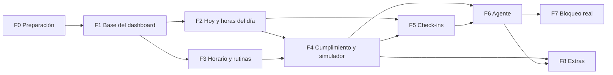

# Tareas — Rastreador de tiempo + modo meta

> Plan de trabajo por fases. La especificación está en [arquitectura.md](arquitectura.md).

## Cómo usar este archivo con Claude Code

1. Abre Claude Code en la carpeta del proyecto.
2. Pide una tarea a la vez, por ejemplo: "Lee docs/arquitectura.md y la tarea F1-03 de docs/tareas.md. Propón un plan antes de escribir código."
3. Revisa el plan y da el OK.
4. Comprueba tú cada punto de **Hecho cuando**.
5. Marca la casilla de la tarea. Si cambió alguna decisión, anótala en el registro de cambios de la arquitectura.

### Reglas para Claude Code (puedes copiarlas a tu CLAUDE.md)

- Leer `docs/arquitectura.md` antes de cada tarea y respetar la columna "Depende de".
- Una sola tarea por vez: proponer un plan corto y esperar el OK de Dremy.
- Explicar paso a paso y de forma concisa: Dremy está aprendiendo HTML, CSS y JS (viene de C++).
- No reescribir ni recortar los comentarios que Dremy escribió en el código.
- Dashboard en HTML, CSS y JS con módulos ES, sin frameworks ni paso de build. Única librería: ECharts (archivo local).
- El motor (`web/motor/`) no usa DOM, red ni el reloj del sistema: todo entra por parámetros, y cada función tiene pruebas.
- Colores y tipografía solo desde `css/tokens.css`. No inventar el estilo final.
- No subir al repositorio datos reales de ActivityWatch (títulos y URLs son privados) ni tokens o claves.
- Si algo de la arquitectura no encaja, proponer el cambio y actualizar `docs/arquitectura.md`.

## Leyenda

| Campo | Valores |
|---|---|
| Dificultad | 1 = configuración · 2 = fácil · 3 = media (varias piezas o decisiones) · 4 = difícil (fechas, casos borde, integración con Windows o el navegador) · 5 = muy difícil (ninguna tarea llega a 5) |
| Tamaño | S = menos de 1 h · M = 1 a 3 h · L = 3 a 6 h (con Claude Code; orientativo) |
| Prioridad | Esencial = necesaria para su hito · Importante · Extra |
| Dónde | Repo · AW (configuración de ActivityWatch) · Dashboard · Motor · Agente · Extensión · Tú (sin código) |

## Hitos

| Hito | Fases | Qué tienes al final | Horas aprox. |
|---|---|---|---|
| 1. Dashboard con simulador | 0 a 4 | Ves en qué se va tu tiempo, tu plan contra la realidad y qué habría hecho el bloqueo | ≈ 80 h |
| 2. Horario que te acompaña | 5 y 6 | Horas despierto exactas, rutinas fuera de la PC y avisos de Windows antes de cada bloque | ≈ 18 h |
| 3. Bloqueo real | 7 | Aviso, fricción y total en apps y webs | ≈ 19 h |
| 4. Extras | 8 | Revisión semanal e integraciones | ≈ 10 h |

Las horas son la suma de los tamaños (S ≈ 0,5 h, M ≈ 2 h, L ≈ 4,5 h): solo dan una idea de escala.

## Dependencias entre fases

**Ruta crítica del Hito 1** (la cadena con más horas estimadas): F0-01 → F0-05 → F1-03 → F1-04 → F1-05 → F4-01 → F4-05 → F4-06 → F4-07.

**Orden sugerido para el Hito 1**

1. Fase 0 completa.
2. F1-01, F1-02, F1-03, F1-06, F1-08, F1-04, F1-05, F1-07.
3. F2-01, F2-08, F2-03, F2-04, F2-02, F2-07, F2-05 (F2-06 cuando quieras).
4. F3-01, F3-02, F3-03, F3-04, F3-07, F3-06, F3-08, F3-05.
5. F4-01 a F4-08, en orden.

---

## Fase 0 — Preparación

**Resultado:** entorno listo y categorías definidas. **Aprendes:** cómo guarda y clasifica datos ActivityWatch.

| ID | Tarea | Dónde | Depende de | Dif. | Tamaño | Prioridad |
|---|---|---|---|---|---|---|
| F0-01 | Crear repositorio y carpetas | Repo | — | 1 | S | Esencial |
| F0-02 | Revisar el entorno de AW | Tú | — | 1 | S | Esencial |
| F0-03 | Instalar aw-watcher-web | AW | F0-02 | 1 | S | Esencial |
| F0-04 | Definir categorías en AW | AW | F0-03 | 2 | M | Esencial |
| F0-05 | Servir `web/` desde AW | AW | F0-01, F0-02 | 2 | S | Esencial |
| F0-06 | Preparar datos de ejemplo | Tú | F0-03 | 1 | S | Esencial |
| F0-07 | Responder "Por validar" | Tú | — | 1 | S | Esencial |

- [x] **F0-01 · Crear repositorio y carpetas**
  - Hecho cuando: el repo está en GitHub con la estructura de la arquitectura (§15), incluido el `package.json` de la raíz; `docs/` tiene `arquitectura.md` y `tareas.md`; `.gitignore` excluye `datos-reales/`, `docs/_por_borrar/`, el estado personal de Obsidian y los secretos.
- [x] **F0-02 · Revisar el entorno de AW**
  - Hecho cuando: la tabla "Entorno" (§16) está completa.
  - Notas: abrir `http://localhost:5600/api/0/info`; si la versión termina en "(rust)", el servidor es el de Rust.
- [ ] **F0-03 · Instalar aw-watcher-web**
  - Hecho cuando: en `/api/0/buckets/` aparece un `aw-watcher-web-<navegador>_<host>` por cada navegador que usas.
- [ ] **F0-04 · Definir categorías en AW**
  - Objetivo: el árbol Clase > Subcategoría de §7, con reglas regex.
  - Hecho cuando: existen las 3 clases con sus subcategorías y lo "Sin clasificar" es menos del 15 % del tiempo activo de los últimos 3 días.
  - Notas: usar el Asistente de categorización (`#/category-builder`). Claude Code puede sugerir las regex.
- [x] **F0-05 · Servir `web/` desde AW**
  - Hecho cuando: `http://localhost:5600/pages/rastreador/` muestra un `index.html` de prueba que importa un módulo `.js` y este se ejecuta.
  - Notas: configuración según §14; copiar la configuración antes de editarla y reiniciar AW después. Si el módulo no carga por el tipo MIME, ver §14.
- [ ] **F0-06 · Preparar datos de ejemplo**
  - Objetivo: 2 o 3 días exportados de AW (ventana, AFK y web), con una copia anonimizada para las pruebas.
  - Hecho cuando: `datos-ejemplo/` tiene la copia anonimizada y los datos reales quedan fuera del repo.
  - Notas: incluir un día con trasnoche y otro con huecos sin PC.
- [ ] **F0-07 · Responder "Por validar"**
  - Hecho cuando: cada punto de §17 tiene respuesta.

---

## Fase 1 — Base del dashboard

**Resultado:** ves el tiempo de hoy por clase. **Aprendes:** módulos ES, `fetch` y `async/await`, JSON, DOM y variables CSS.

| ID | Tarea | Dónde | Depende de | Dif. | Tamaño | Prioridad |
|---|---|---|---|---|---|---|
| F1-01 | Esqueleto y navegación | Dashboard | F0-05 | 2 | M | Esencial |
| F1-02 | Sistema de estilo (tokens) | Dashboard | F1-01 | 2 | M | Esencial |
| F1-03 | Cliente de AW | Dashboard | F0-05 | 3 | M | Esencial |
| F1-04 | Consulta canónica categorizada | Dashboard | F1-03, F0-04 | 4 | L | Esencial |
| F1-05 | Segmentos (Clasificador) | Motor | F1-04, F1-08 | 3 | M | Esencial |
| F1-06 | Librería de gráficos | Dashboard | F1-02 | 2 | S | Esencial |
| F1-07 | Vista Hoy mínima | Dashboard | F1-05, F1-06 | 2 | M | Esencial |
| F1-08 | Base de pruebas del motor | Motor | F0-06 | 2 | S | Esencial |

- [x] **F1-01 · Esqueleto y navegación**
  - Objetivo: `index.html` con menú y rutas con `#`: hoy, horas, horario, cumplimiento, simulador, clasificacion, diario y ajustes. Cada vista en su propio archivo.
  - Hecho cuando: se navega sin recargar y, al recargar, se mantiene la vista.
- [x] **F1-02 · Sistema de estilo (tokens)**
  - Objetivo: variables CSS para cada clase y estado (estudio, distracción, neutral, sin clasificar, AFK, sin PC), acento, tipografía y espaciado; modo oscuro; componentes base (tarjeta, KPI, barra de progreso, etiqueta).
  - Hecho cuando: cambiar un color en `tokens.css` cambia todo el dashboard, y hay una página de muestra de componentes.
  - Notas: la paleta y la tipografía las decides tú. Hoy hay una **provisional** en `tokens.css` (marcada así); la definitiva se cambia solo ahí.
- [x] **F1-03 · Cliente de AW**
  - Objetivo: un solo módulo para la API (§14): info, buckets, eventos, consultas, ajustes, crear bucket, insertar eventos y latido.
  - Hecho cuando: cada función funciona contra tu servidor; si AW no responde, el dashboard muestra un aviso en vez de romperse.
- [ ] **F1-04 · Consulta canónica categorizada**
  - Objetivo: para un día, eventos de ventana sin AFK, categorizados con `classes`, más los eventos del navegador.
  - Hecho cuando: los totales por categoría de un día coinciden con la vista Actividad de AW (±1 min).
  - Notas: partir de `canonicalEvents` y `classes_for_query` de aw-webui (§14); cuidado con el escape de las regex; pedir día por día.
- [ ] **F1-05 · Segmentos (Clasificador)**
  - Objetivo: convertir eventos en segmentos (inicio, fin, clase, subcategoría, app, título) y rellenar los huecos como AFK o Sin PC.
  - Hecho cuando: un día queda cubierto sin solapes ni huecos (la suma da la duración del rango) y las pruebas pasan.
- [x] **F1-06 · Librería de gráficos**
  - Objetivo: ECharts en `web/lib/` con un tema propio que lee los tokens.
  - Hecho cuando: un gráfico de prueba usa los colores de `tokens.css` y cambia con el modo oscuro.
- [ ] **F1-07 · Vista Hoy mínima**
  - Objetivo: tiempo activo de hoy y barra apilada por clase.
  - Hecho cuando: coincide con AW y se actualiza cada minuto sin recargar.
- [ ] **F1-08 · Base de pruebas del motor**
  - Objetivo: carpeta `pruebas/` con el test runner de Node y los datos de `datos-ejemplo/`.
  - Hecho cuando: un solo comando corre todas las pruebas.

---

## Fase 2 — Hoy y horas del día

**Resultado:** línea de tiempo real, gráficos por hora y horas despierto estimadas. **Aprendes:** fechas y zonas horarias, agregaciones y gráficos.

| ID | Tarea | Dónde | Depende de | Dif. | Tamaño | Prioridad |
|---|---|---|---|---|---|---|
| F2-01 | Día lógico estimado | Motor | F1-05 | 3 | M | Esencial |
| F2-02 | Horas despierto y su reparto | Dashboard | F2-01, F1-07 | 2 | M | Esencial |
| F2-03 | Línea de tiempo de 24 h (carril Real) | Dashboard | F1-05, F1-06 | 4 | L | Esencial |
| F2-04 | Barras por hora | Dashboard | F1-05, F1-06 | 2 | S | Esencial |
| F2-05 | Mapa de calor hora × día | Dashboard | F2-04, F2-08 | 3 | M | Importante |
| F2-06 | Reloj de 24 h | Dashboard | F2-04 | 3 | M | Extra |
| F2-07 | Más usados y sin clasificar | Dashboard | F1-05 | 2 | M | Importante |
| F2-08 | Selector de fecha y caché | Dashboard | F1-04 | 3 | M | Esencial |

- [ ] **F2-01 · Día lógico estimado**
  - Objetivo: inicio y fin del día según §10, todavía sin check-ins.
  - Hecho cuando: la actividad de la 1:00 a. m. cuenta para el día anterior, y hay pruebas con trasnoche y con días sin datos.
- [ ] **F2-02 · Horas despierto y su reparto**
  - Objetivo: "Despierto desde HH:MM · X h" y una barra con el reparto (estudio, distracción, neutral, sin clasificar, AFK, sin PC).
  - Hecho cuando: el reparto suma exactamente las horas despierto.
- [ ] **F2-03 · Línea de tiempo de 24 h (carril Real)**
  - Objetivo: segmentos coloreados por clase a lo largo del día lógico, con detalle al pasar el mouse (app, título, duración y, en las webs, la URL completa) y zoom.
  - Hecho cuando: un día completo se ve fluido y el detalle coincide con el Timeline de AW.
  - Notas: diseñarla con carriles; después se suman Plan (F3-06) e Intervenciones (F4-07).
- [ ] **F2-04 · Barras por hora**
  - Objetivo: barras de 0 a 23 h, apiladas por clase.
  - Hecho cuando: ninguna barra pasa de 60 min y la suma del día coincide con el total.
- [ ] **F2-05 · Mapa de calor hora × día**
  - Objetivo: últimas N semanas, filtrable por clase o por curso.
  - Hecho cuando: cambiar el filtro actualiza el mapa y cada celda muestra los minutos promedio.
- [ ] **F2-06 · Reloj de 24 h**
  - Objetivo: vista radial del día; la vista Timespiral de AW sirve de referencia.
  - Hecho cuando: muestra el día lógico con los mismos colores que la línea de tiempo.
- [ ] **F2-07 · Más usados y sin clasificar**
  - Objetivo: apps y sitios más usados por clase, y lo más usado sin clasificar, con enlace al Asistente de categorización de AW. Los sitios se agrupan por dominio y cada dominio se despliega en sus URLs completas.
  - Hecho cuando: cada fila muestra app o sitio, tiempo y clase, y cada dominio muestra sus URLs con su tiempo.
- [ ] **F2-08 · Selector de fecha y caché**
  - Objetivo: elegir día o rango; los días terminados se guardan en caché.
  - Hecho cuando: volver a un día ya visto es instantáneo y hoy siempre se refresca.

---

## Fase 3 — Horario y rutinas

**Resultado:** tu plan y la realidad, lado a lado. **Aprendes:** modelado de datos, formularios, validación y repeticiones semanales.

| ID | Tarea | Dónde | Depende de | Dif. | Tamaño | Prioridad |
|---|---|---|---|---|---|---|
| F3-01 | Modelo del plan y validación | Motor | F0-07, F1-08 | 3 | M | Esencial |
| F3-02 | Guardar el plan en AW y respaldo | Dashboard | F3-01, F1-03 | 2 | S | Esencial |
| F3-03 | Expansor de horario | Motor | F3-01 | 4 | M | Esencial |
| F3-04 | Vista Horario: editor | Dashboard | F3-02, F1-02 | 4 | L | Esencial |
| F3-05 | Planificador semanal | Dashboard | F3-03, F3-04 | 4 | L | Importante |
| F3-06 | Carril Plan y bloque actual en Hoy | Dashboard | F3-03, F2-03 | 3 | M | Esencial |
| F3-07 | Cargar tu horario 2026-2 | Tú | F3-04 | 1 | S | Esencial |
| F3-08 | Empezar bloque ahora | Dashboard | F3-02, F3-03 | 2 | S | Importante |

- [ ] **F3-01 · Modelo del plan y validación**
  - Objetivo: el modelo de §8, con validación de campos obligatorios, horas válidas y solapes.
  - Hecho cuando: un plan inválido da mensajes claros y las pruebas pasan.
- [ ] **F3-02 · Guardar el plan en AW y respaldo**
  - Objetivo: leer y escribir el ajuste `rastreador-plan`; exportar e importar JSON.
  - Hecho cuando: el plan sobrevive a reiniciar AW, y exportar → importar lo deja idéntico.
- [ ] **F3-03 · Expansor de horario**
  - Objetivo: plantilla semanal + bloques únicos + excepciones → bloques concretos de un día lógico.
  - Hecho cuando: hay pruebas para feriado, semana de exámenes, bloque que cruza la medianoche y fin de ciclo.
  - Notas: zona America/Lima.
- [ ] **F3-04 · Vista Horario: editor**
  - Objetivo: formularios para ciclo, cursos (color, meta semanal, categoría), clases, rutinas, bloques (nivel, objetivo, por qué) y excepciones.
  - Hecho cuando: todo el horario de un ciclo se carga solo desde el dashboard.
- [ ] **F3-05 · Planificador semanal**
  - Objetivo: cuadrícula de lunes a domingo con clases, rutinas y bloques; crear un bloque haciendo clic en un hueco.
  - Hecho cuando: la semana se ve completa y los cambios se guardan en el plan.
  - Notas: arrastrar y soltar puede esperar.
- [ ] **F3-06 · Carril Plan y bloque actual en Hoy**
  - Objetivo: carril Plan en la línea de tiempo y tarjeta "bloque actual / siguiente" con cuenta regresiva.
  - Hecho cuando: el bloque actual cambia solo al llegar la hora.
- [ ] **F3-07 · Cargar tu horario 2026-2**
  - Objetivo: clases, rutinas y bloques reales de la semana.
  - Hecho cuando: la semana actual se ve completa en Hoy y en el planificador.
- [ ] **F3-08 · Empezar bloque ahora**
  - Objetivo: botón en Hoy que crea un bloque único desde este momento (curso, duración, nivel, por qué), y "Terminar antes" con motivo.
  - Hecho cuando: el bloque aparece al instante en el carril Plan, y al terminarlo antes guarda la hora real y el motivo.

---

## Fase 4 — Cumplimiento y simulador

**Resultado (Hito 1):** el dashboard muestra tu cumplimiento y qué habría hecho el bloqueo. **Aprendes:** lógica pura, pruebas automáticas y reglas de negocio.

| ID | Tarea | Dónde | Depende de | Dif. | Tamaño | Prioridad |
|---|---|---|---|---|---|---|
| F4-01 | Contexto de cada segmento | Motor | F3-03, F1-05 | 3 | M | Esencial |
| F4-02 | Cumplimiento por bloque | Motor | F4-01 | 4 | L | Esencial |
| F4-03 | Cumplimiento diario, semanal y por curso | Motor | F4-02 | 3 | M | Esencial |
| F4-04 | Configuración de niveles | Dashboard | F3-02 | 2 | M | Esencial |
| F4-05 | Decisor | Motor | F4-01, F4-04 | 4 | L | Esencial |
| F4-06 | Simulador | Motor | F4-05 | 4 | L | Esencial |
| F4-07 | Vista Simulador | Dashboard | F4-06, F2-03 | 3 | M | Esencial |
| F4-08 | Vista Cumplimiento | Dashboard | F4-03, F1-06 | 3 | L | Esencial |

- [ ] **F4-01 · Contexto de cada segmento**
  - Objetivo: marcar cada segmento como en bloque, en clase, en rutina o libre.
  - Hecho cuando: la distracción en tiempo libre no cuenta como fallo, y hay pruebas en los bordes de los bloques.
- [ ] **F4-02 · Cumplimiento por bloque**
  - Objetivo: estado cumplido, parcial, fallido o no medible según §9, con los umbrales del plan.
  - Hecho cuando: hay pruebas para cada tipo de bloque y de rutina.
  - Notas: el estudio en papel se completa en F5-03, porque necesita check-ins.
- [ ] **F4-03 · Cumplimiento diario, semanal y por curso**
  - Objetivo: % del día y de la semana con la fórmula de §9; horas por curso contra su meta.
  - Hecho cuando: un día armado a mano en las pruebas da el % esperado.
- [ ] **F4-04 · Configuración de niveles**
  - Objetivo: ajuste `rastreador-niveles` y su sección en Ajustes, con la regla de asimetría de §11.
  - Hecho cuando: bajar un nivel muestra "se aplica mañana" y subirlo es inmediato.
  - Notas: cada cambio pendiente se guarda con `aplica_desde`; la configuración vigente la calcula el motor (§11).
- [ ] **F4-05 · Decisor**
  - Objetivo: actividad + bloque activo + nivel + pases + avisos acumulados → permitir, aviso, fricción o bloqueo, con escalamiento.
  - Hecho cuando: hay pruebas para cada nivel, para el escalamiento tras 3 avisos, para `nunca_bloquear` y para lo sin clasificar en total.
  - Notas: no conoce el reloj ni la red; así sirve igual para el simulador y para el agente.
- [ ] **F4-06 · Simulador**
  - Objetivo: correr el Decisor sobre los segmentos de un día con un nivel elegido → intervenciones simuladas y minutos que se habrían cortado.
  - Hecho cuando: el mismo día con el mismo nivel siempre da el mismo resultado, y se pueden comparar los 3 niveles.
- [ ] **F4-07 · Vista Simulador**
  - Objetivo: carril Intervenciones en la línea de tiempo, lista de intervenciones y resumen por nivel.
  - Hecho cuando: cambiar de día o de nivel actualiza todo en menos de 1 s.
- [ ] **F4-08 · Vista Cumplimiento**
  - Objetivo: calendario de días cumplidos, puntualidad, % de foco por bloque y horas por curso contra la meta.
  - Hecho cuando: un clic en un día del calendario abre ese día en Hoy.

---

## Fase 5 — Check-ins y día lógico preciso

**Resultado:** horas despierto exactas, rutinas fuera de la PC y estudio en papel. **Aprendes:** guardar eventos propios y corregir datos.

| ID | Tarea | Dónde | Depende de | Dif. | Tamaño | Prioridad |
|---|---|---|---|---|---|---|
| F5-01 | Registro de check-ins | Dashboard | F1-03 | 2 | M | Esencial |
| F5-02 | Día lógico con check-ins | Motor | F5-01, F2-01 | 3 | M | Esencial |
| F5-03 | Estudio en papel y rutinas con check-in | Motor | F5-01, F4-02 | 2 | S | Esencial |
| F5-04 | Vista Diario | Dashboard | F5-01 | 2 | M | Importante |
| F5-05 | Rachas por rutina | Dashboard | F5-03, F4-08 | 2 | S | Importante |

- [ ] **F5-01 · Registro de check-ins**
  - Objetivo: crear `rastreador-checkins_<host>` y registrar despertar, dormir, rutina hecha, estudio en papel y asistencia desde el dashboard.
  - Hecho cuando: cada check-in aparece en el Timeline de AW y en la vista Diario.
- [ ] **F5-02 · Día lógico con check-ins**
  - Objetivo: usar los check-ins de despertar y dormir en el cálculo del día lógico.
  - Hecho cuando: el check-in de despertar manda sobre la estimación y se puede corregir un día pasado.
- [ ] **F5-03 · Estudio en papel y rutinas con check-in**
  - Objetivo: completar las reglas de §9 que dependen de check-ins.
  - Hecho cuando: un bloque en papel con la PC en AFK y check-in "hecho" sale cumplido; con distracción en la PC sale parcial.
- [ ] **F5-04 · Vista Diario**
  - Objetivo: por día, check-ins e intervenciones con su motivo; editar o borrar errores.
  - Hecho cuando: borrar un check-in actualiza el cumplimiento.
- [ ] **F5-05 · Rachas por rutina**
  - Objetivo: racha de días cumplidos por rutina en la vista Cumplimiento.
  - Hecho cuando: cada rutina muestra su racha actual y la mejor.

---

## Fase 6 — Agente de escritorio

**Resultado (Hito 2):** Windows te avisa de tu horario y el agente sabe qué pasa en vivo. **Aprendes:** Node.js, procesos del sistema, APIs locales y arranque con Windows.

| ID | Tarea | Dónde | Depende de | Dif. | Tamaño | Prioridad |
|---|---|---|---|---|---|---|
| F6-01 | Proyecto del agente | Agente | F4-05, F3-02 | 3 | M | Esencial |
| F6-02 | Clasificación en vivo | Motor | F1-05 | 3 | M | Esencial |
| F6-03 | Ventana activa y procesos | Agente | F6-01 | 4 | M | Esencial |
| F6-04 | Notificaciones del horario | Agente | F6-01, F3-03 | 3 | M | Esencial |
| F6-05 | Check-in al despertar | Agente | F6-04, F5-02 | 3 | S | Importante |
| F6-06 | API local del agente | Agente | F6-01 | 3 | M | Esencial |
| F6-07 | Sesiones reales y latido | Agente | F6-01 | 2 | S | Esencial |
| F6-08 | Panel en vivo en Hoy | Dashboard | F6-06 | 2 | S | Importante |

- [ ] **F6-01 · Proyecto del agente**
  - Objetivo: proceso Node que importa `web/motor/`, lee plan, niveles y categorías de AW cada minuto y escribe un log.
  - Hecho cuando: arranca solo al iniciar sesión en Windows y sigue funcionando si AW se reinicia.
- [ ] **F6-02 · Clasificación en vivo**
  - Objetivo: clasificar una actividad suelta (app + título y, si es una web, la URL) con las reglas de `classes`, con el mismo criterio que AW (§7).
  - Hecho cuando: con los datos de ejemplo da la misma categoría que AW en al menos el 99 % de los eventos; las reglas que no compilan en JS aparecen en la vista Clasificación.
  - Notas: el criterio de AW está en `classify.rs` (§14).
- [ ] **F6-03 · Ventana activa y procesos**
  - Objetivo: app y título activos, y procesos abiertos, leídos directamente de Windows.
  - Hecho cuando: detecta un cambio de ventana en menos de 2 s.
  - Notas: no depender de AW para esto; guarda con hasta ~10 s de retraso.
- [ ] **F6-04 · Notificaciones del horario**
  - Objetivo: aviso 5 min antes, al inicio y al final de cada bloque y rutina; al hacer clic se abre el dashboard.
  - Hecho cuando: en un día real llegan todos los avisos a su hora.
- [ ] **F6-05 · Check-in al despertar**
  - Objetivo: con la primera actividad del día lógico, preguntar a qué hora te despertaste.
  - Hecho cuando: la respuesta queda guardada y Hoy muestra la hora correcta.
- [ ] **F6-06 · API local del agente**
  - Objetivo: en `127.0.0.1:5650`: estado actual, decisión para una página, pedir pase y salida de emergencia.
  - Hecho cuando: responde solo al dashboard, a las páginas de bloqueo y a la extensión.
- [ ] **F6-07 · Sesiones reales y latido**
  - Objetivo: guardar el inicio y el fin reales de cada bloque (`rastreador-sesiones`) y un latido por minuto (`rastreador-agente`).
  - Hecho cuando: si cierras el agente durante un bloque, el dashboard lo marca.
- [ ] **F6-08 · Panel en vivo en Hoy**
  - Objetivo: bloque actual, nivel, pases activos, avisos acumulados y estado del agente.
  - Hecho cuando: el panel cambia en menos de 5 s cuando cambia el estado del agente.

---

## Fase 7 — Bloqueo real

**Resultado (Hito 3):** aviso, fricción y total funcionando en apps y webs. **Aprendes:** extensiones Manifest V3, comunicación entre procesos y seguridad básica.

| ID | Tarea | Dónde | Depende de | Dif. | Tamaño | Prioridad |
|---|---|---|---|---|---|---|
| F7-01 | Páginas de bloqueo | Dashboard | F1-02, F6-06 | 3 | M | Esencial |
| F7-02 | Aviso en apps | Agente | F6-02, F6-03, F6-04, F4-05 | 3 | M | Esencial |
| F7-03 | Extensión del navegador | Extensión | F6-06, F7-01 | 4 | L | Esencial |
| F7-04 | Fricción en webs y apps | Agente y extensión | F7-02, F7-03 | 4 | M | Esencial |
| F7-05 | Total en webs y apps | Agente y extensión | F7-04 | 4 | L | Esencial |
| F7-06 | Escalamiento y asimetría | Agente | F7-04, F4-04 | 3 | M | Importante |
| F7-07 | Simulador = realidad | Motor y agente | F7-05, F4-06 | 3 | M | Esencial |

- [ ] **F7-01 · Páginas de bloqueo**
  - Objetivo: aviso, fricción, total y salida de emergencia en `web/bloqueo/`, con tu estilo; muestran el bloque, el tiempo restante y tu "por qué".
  - Hecho cuando: cada página funciona sola con parámetros de prueba.
- [ ] **F7-02 · Aviso en apps**
  - Objetivo: al enfocar una app de distracción durante un bloque: notificación, intervención registrada y permiso de 5 min tras "continuar".
  - Hecho cuando: lo registrado coincide con lo que el simulador predice para ese momento.
- [ ] **F7-03 · Extensión del navegador**
  - Objetivo: en cada navegación, preguntar al agente y redirigir a la página que corresponda; latido cada 30 s con el nombre del navegador (§6.4).
  - Hecho cuando: nunca bloquea el dashboard ni las páginas de bloqueo; funciona en incógnito; si el agente no responde, mantiene la última decisión hasta el fin del bloque.
  - Notas: "Permitir en incógnito" se activa a mano en el navegador.
- [ ] **F7-04 · Fricción en webs y apps**
  - Objetivo: espera + motivo → pase temporal que gasta un comodín.
  - Hecho cuando: sin comodines no hay pase, y cada pase queda registrado con su motivo.
- [ ] **F7-05 · Total en webs y apps**
  - Objetivo: sin pases; las apps de distracción y los navegadores sin la extensión se cierran al abrirse; salida de emergencia con espera y frase.
  - Hecho cuando: un bloque total de prueba de 15 min funciona de principio a fin.
  - Notas: nunca cerrar procesos del sistema, el agente, AW ni lo de `nunca_bloquear`. La salida de emergencia debe funcionar siempre.
- [ ] **F7-06 · Escalamiento y asimetría**
  - Objetivo: aplicar en vivo las reglas de escalamiento y asimetría de §11.
  - Hecho cuando: 3 avisos en un bloque lo suben a fricción, y aflojar una regla se aplica recién al día siguiente.
- [ ] **F7-07 · Simulador = realidad**
  - Objetivo: comparar un día con bloqueo real contra la simulación de ese mismo día.
  - Hecho cuando: salen las mismas intervenciones, o cada diferencia está explicada y corregida.

---

## Fase 8 — Extras

**Resultado (Hito 4):** revisión semanal e integraciones. **Aprendes:** integraciones con otras apps (calendario, Notion).

| ID | Tarea | Dónde | Depende de | Dif. | Tamaño | Prioridad |
|---|---|---|---|---|---|---|
| F8-01 | Revisión semanal automática | Dashboard | F4-03 | 3 | M | Importante |
| F8-02 | Importar horario (.ics o Notion) | Dashboard | F3-01 | 3 | M | Extra |
| F8-03 | Respaldo automático del plan | Dashboard | F3-02 | 1 | S | Importante |
| F8-04 | Sesiones a Notion | Agente | F6-07 | 3 | M | Extra |
| F8-05 | PomoRem inicia bloques | PomoRem | F6-06 | 3 | M | Extra |
| F8-06 | Sueño contra rendimiento | Dashboard | F5-02, F4-03 | 2 | S | Extra |
| F8-07 | Dashboard dentro de AW | Dashboard | F2-03 | 2 | S | Extra |

- [ ] **F8-01 · Revisión semanal automática**
  - Objetivo: cada domingo, plan contra realidad, mejores horas, distracciones principales y sugerencias por reglas (por ejemplo, "tus bloques de las 19:00 fallan seguido").
- [ ] **F8-02 · Importar horario**
  - Objetivo: traer las clases desde un archivo .ics (Google Calendar) o desde Notion.
- [ ] **F8-03 · Respaldo automático del plan**
  - Objetivo: exportar el plan y los niveles a JSON cada semana.
- [ ] **F8-04 · Sesiones a Notion**
  - Objetivo: al cerrar un bloque, enviar el resumen a tu base "Sesiones de estudio".
  - Notas: el token de Notion va fuera del repo.
- [ ] **F8-05 · PomoRem inicia bloques**
  - Objetivo: que al empezar un pomodoro, PomoRem pida un bloque a la API del agente, para que el dashboard y el bloqueo lo reconozcan.
- [ ] **F8-06 · Sueño contra rendimiento**
  - Objetivo: horas dormidas contra el foco del día siguiente.
- [ ] **F8-07 · Dashboard dentro de AW**
  - Objetivo: mostrar Hoy como visualización personalizada en la vista Actividad de AW (recibe `hostname`, `start` y `end`).
